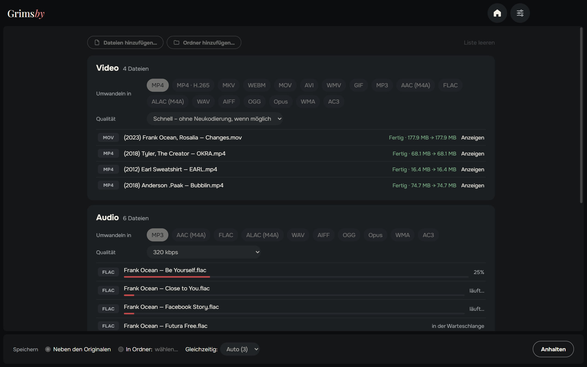
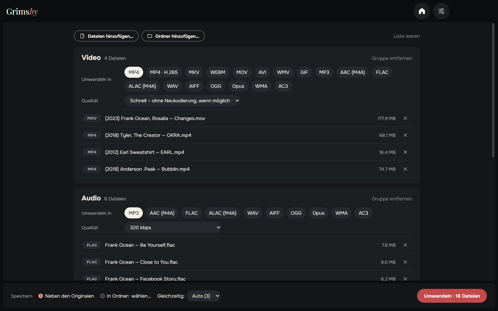
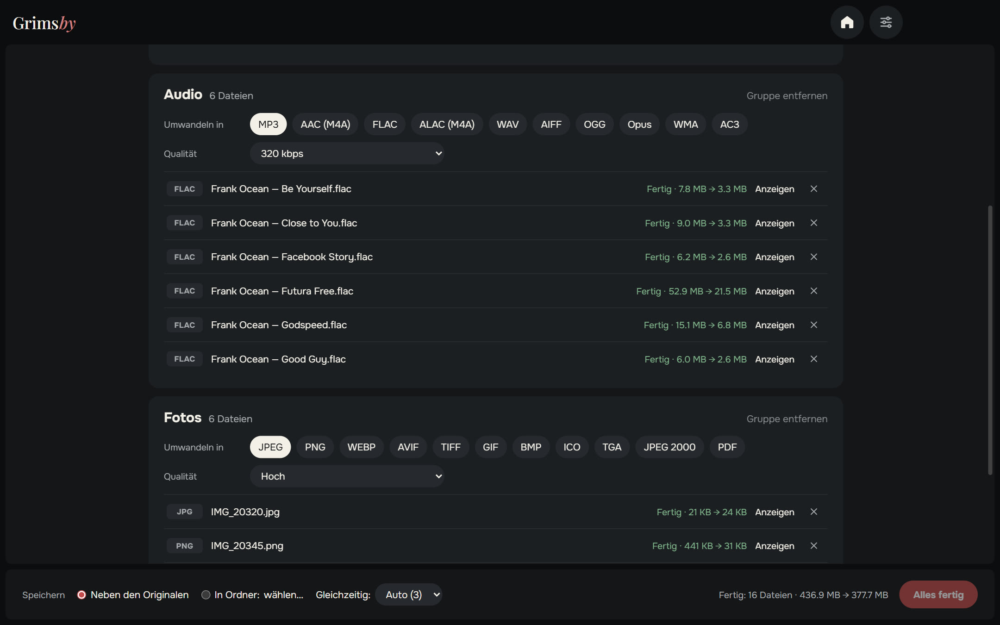
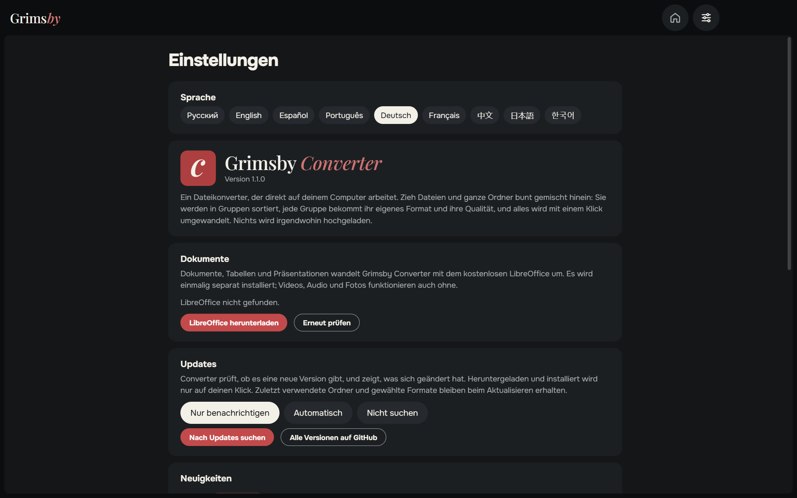
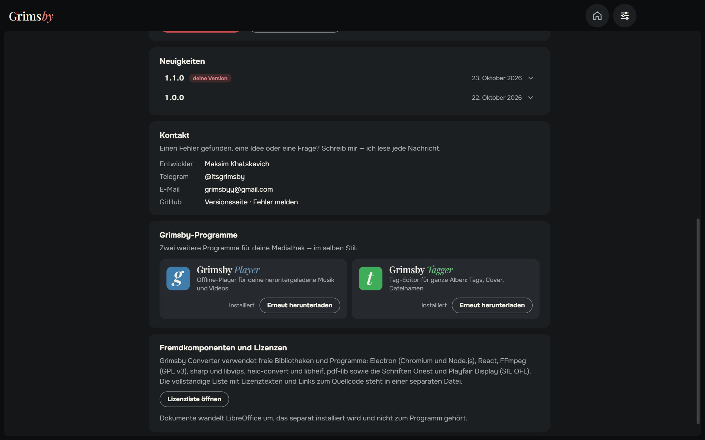
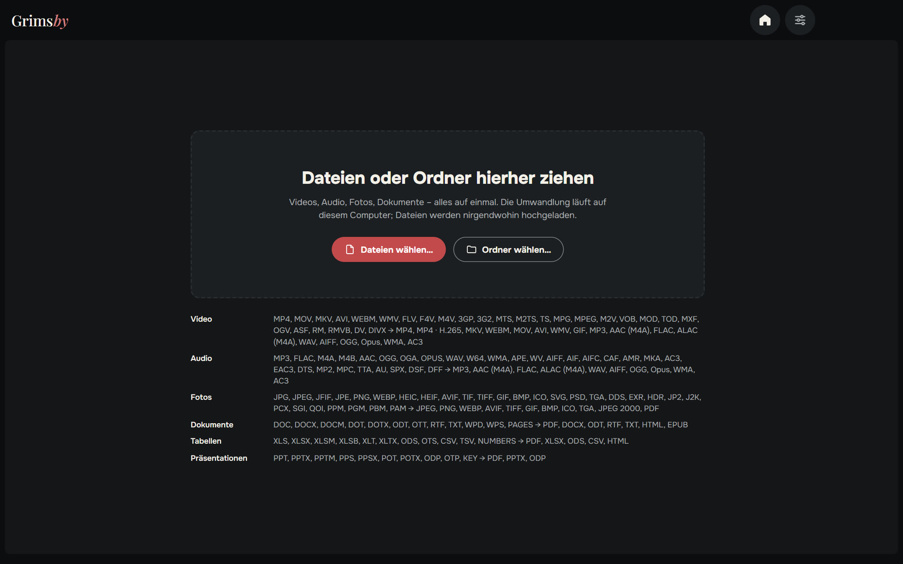

  <a href="README.md">English</a> ·
  <a href="README.ru.md">Русский</a> ·
  <a href="README.es.md">Español</a> ·
  <a href="README.pt.md">Português</a> ·
  <b>Deutsch</b> ·
  <a href="README.fr.md">Français</a> ·
  <a href="README.zh.md">中文</a> ·
  <a href="README.ja.md">日本語</a> ·
  <a href="README.ko.md">한국어</a>

  

  <b>Videos, Audio, Fotos und Dokumente umwandeln – alles auf einmal, direkt auf deinem PC.</b> 
  Nichts wird hochgeladen: keine Warteschlange auf Webseiten, keine Größenlimits, keine Wasserzeichen.

  
  
  
  
  

  <a href="https://github.com/maksimkhatskevich/grimsby-converter/releases/latest"><b>⬇ Für Windows herunterladen</b></a>
  &nbsp;·&nbsp;
  <a href="#funktionen">Funktionen</a>
  &nbsp;·&nbsp;
  <a href="#formate">Formate</a>
  &nbsp;·&nbsp;
  <a href="#feedback">Feedback</a>

---

## Warum Grimsby Converter

Ein FLAC-Album als MP3 fürs Handy, ein MOV vom iPhone als MP4, HEIC-Fotos als JPG und ein DOCX als PDF? Normalerweise heißt das: vier verschiedene Webseiten, private Dateien auf fremde Server hochladen und warten.

**Grimsby Converter erledigt das in einem Fenster.** Zieh Dateien und Ordner bunt gemischt hinein – sie werden in Gruppen sortiert, jede Gruppe bekommt ihr Format und ihre Qualität. Ein Klick, und alles wird auf deinem Computer umgewandelt.

| | Online-Konverter | **Grimsby Converter** |
|---|:---:|:---:|
| Dateien bleiben auf deinem Computer | ✕ | **✓** |
| Keine Größenlimits, keine Warteschlange | ✕ | **✓** |
| Videos, Audio, Fotos und Dokumente an einem Ort | selten | **✓** |
| Ganze Ordner auf einmal | ✕ | **✓** |
| Funktioniert ohne Internet | ✕ | **✓** |
| Keine Werbung, keine Wasserzeichen, keine Anmeldung | selten | **✓** |

---

## Funktionen

### 📥 Alles auf einmal hineinziehen

Zieh Dateien oder ganze Ordner ins Fenster – Videos, Musik, Fotos und Dokumente gemischt. Grimsby sortiert sie nach Typ in Gruppen und zeigt, wie viele Dateien jede enthält.

### 🎚 Jede Gruppe mit eigenen Einstellungen

Wähle Zielformat und Qualität pro Gruppe: etwa Videos als MP4, Musik als MP3 320 kbit/s, Fotos als WEBP.

- **Video – Modus „Schnell“:** Passt der Codec in den neuen Container, wird das Video nur umverpackt (MOV → MP4 in Sekunden, ohne Qualitätsverlust). Sonst – oder wenn viele Player das Format nicht öffnen – wird neu kodiert. **MP4 · H.265** macht die Datei etwa halb so groß.
- **Audio:** von MP3 und FLAC bis DSD, DTS und M4B-Hörbüchern; speichert auch als ALAC, AIFF, WMA und mehr. Tags werden übernommen.
- **Fotos:** HEIC vom iPhone, Photoshop-PSD, EXR, HDR, AVIF, SVG – alles öffnet sich und wird in gängigen Formaten gespeichert, sogar als PDF.
- **Dokumente, Tabellen, Präsentationen** → PDF, DOCX, XLSX, EPUB und mehr; auch Pages-, Numbers- und Keynote-Dateien öffnen sich.

### ⚡ Schnell und sicher

- Mehrere Dateien gleichzeitig – so viele, wie dein Prozessor schafft.
- **Originale bleiben unangetastet.** Die neue Datei entsteht neben dem Original (oder in einem gewählten Ordner) und erscheint erst, wenn sie fertig ist.
- Bei jeder fertigen Datei siehst du, wie viel Platz gespart wurde; „Anzeigen“ öffnet sie im Explorer.
- Alles für Video, Audio und Fotos ist schon enthalten – nichts weiter zu installieren.

### ⚙️ Einstellungen auf einer Seite

Sprache, Dokumente, Updates (nur melden, automatisch oder nicht prüfen), Neuigkeiten und Feedback – alles auf einer Seite. Das Fenster merkt sich Größe und Position.

🌍 **9 Sprachen:** Englisch, Russisch, Spanisch, Portugiesisch, Deutsch, Französisch, Chinesisch, Japanisch und Koreanisch – umschalten in den Einstellungen, sofort wirksam.

### 🧩 Grimsby-Apps eingebaut

Grimsby Player und Grimsby Tagger mit Beschreibung und Screenshots – direkt aus der App herunterladen und installieren.

---

## Formate

| Gruppe | Öffnet | Speichert als |
|---|---|---|
| 🎬 Video | MP4, MOV, MKV, AVI, WEBM, WMV, FLV, F4V, M4V, 3GP, 3G2, MTS, M2TS, TS, MPG, MPEG, M2V, VOB, MOD, TOD, MXF, OGV, ASF, RM, RMVB, DV, DIVX | MP4, MP4 · H.265, MKV, WEBM, MOV, AVI, WMV, GIF; nur Ton → MP3, AAC (M4A), FLAC, ALAC (M4A), WAV, AIFF, OGG, Opus, WMA, AC3 |
| 🎵 Audio | MP3, FLAC, M4A, M4B, AAC, OGG, OGA, OPUS, WAV, W64, WMA, APE, WV, AIFF, AIF, AIFC, CAF, AMR, MKA, AC3, EAC3, DTS, MP2, MPC, TTA, AU, SPX, DSF, DFF | MP3, AAC (M4A), FLAC, ALAC (M4A), WAV, AIFF, OGG, Opus, WMA, AC3 |
| 🖼 Fotos | JPG, JPEG, JFIF, PNG, WEBP, HEIC, HEIF, AVIF, TIF, TIFF, GIF, BMP, ICO, SVG, PSD, TGA, DDS, EXR, HDR, JP2, J2K, PCX, SGI, QOI, PPM, PGM, PBM, PAM | JPEG, PNG, WEBP, AVIF, TIFF, GIF, BMP, ICO, TGA, JPEG 2000, PDF |
| 📄 Dokumente | DOC, DOCX, DOCM, DOT, DOTX, ODT, OTT, RTF, TXT, WPD, WPS, PAGES | PDF, DOCX, ODT, RTF, TXT, HTML, EPUB |
| 📊 Tabellen | XLS, XLSX, XLSM, XLSB, XLT, XLTX, ODS, OTS, CSV, TSV, NUMBERS | PDF, XLSX, ODS, CSV, HTML |
| 📽 Präsentationen | PPT, PPTX, PPTM, PPS, PPSX, POT, POTX, ODP, OTP, KEY | PDF, PPTX, ODP |

> Dokumente, Tabellen und Präsentationen werden mit dem kostenlosen **LibreOffice** umgewandelt. Ist es nicht installiert, bietet Grimsby den Download an. Video, Audio und Fotos funktionieren sofort.

---

## Herunterladen und installieren

1. Öffne die Seite der **[neuesten Version](https://github.com/maksimkhatskevich/grimsby-converter/releases/latest)** und lade das Installationsprogramm `.exe` herunter.
2. Starte es. Windows zeigt eventuell ein blaues Fenster „Der Computer wurde durch Windows geschützt“ – eine normale Warnung für Programme ohne kostenpflichtiges Signaturzertifikat. Klicke auf **Weitere Informationen → Trotzdem ausführen**.
   Das Installationsprogramm wurde bei VirusTotal geprüft: [keiner der 67 Virenscanner schlägt an](https://www.virustotal.com/gui/file/caeade773641b7b2a15fcc427afa02305a45262004d60aade01427700477fd3b) (Version 1.1.0).
3. Zieh deine Dateien ins Fenster. Fertig.

**Voraussetzungen:** Windows 10 oder 11 (64 Bit).

---

## Datenschutz

Grimsby Converter arbeitet **komplett auf deinem Computer**. Dateien werden nirgendwohin hochgeladen. Kein Konto, keine Werbung, keine Analyse.

---

## Grimsby-Apps

<table>
  <tr>
    <td align="center" width="33%"><a href="https://github.com/maksimkhatskevich/grimsby-releases/blob/main/README.de.md"> <b>Grimsby Player</b></a> Offline-Player für deine heruntergeladene Musik und Videos</td>
    <td align="center" width="33%"> <b>Grimsby Converter</b> </td>
    <td align="center" width="33%"><a href="https://github.com/maksimkhatskevich/grimsby-tagger/blob/main/README.de.md"> <b>Grimsby Tagger</b></a> Tag-Editor für ganze Alben: Tags, Cover, Dateinamen</td>
  </tr>
</table>

---

## Feedback

Einen Fehler gefunden, eine Idee oder einfach Danke sagen? Schreib mir:

- ✉️ E-Mail: **[grimsbyy@gmail.com](mailto:grimsbyy@gmail.com)**
- 🐞 Fehler und Ideen: [Issues](https://github.com/maksimkhatskevich/grimsby-converter/issues)
- 📣 Telegram: [@itsgrimsby](https://t.me/itsgrimsby) (auf Russisch)

---

## Lizenzen

Grimsby Converter nutzt Open-Source-Komponenten, darunter Electron, React, FFmpeg (GPL v3) und libvips. Die vollständige Liste mit Lizenztexten findest du in der App: Einstellungen → Lizenzliste öffnen.

© 2026 Grimsby

