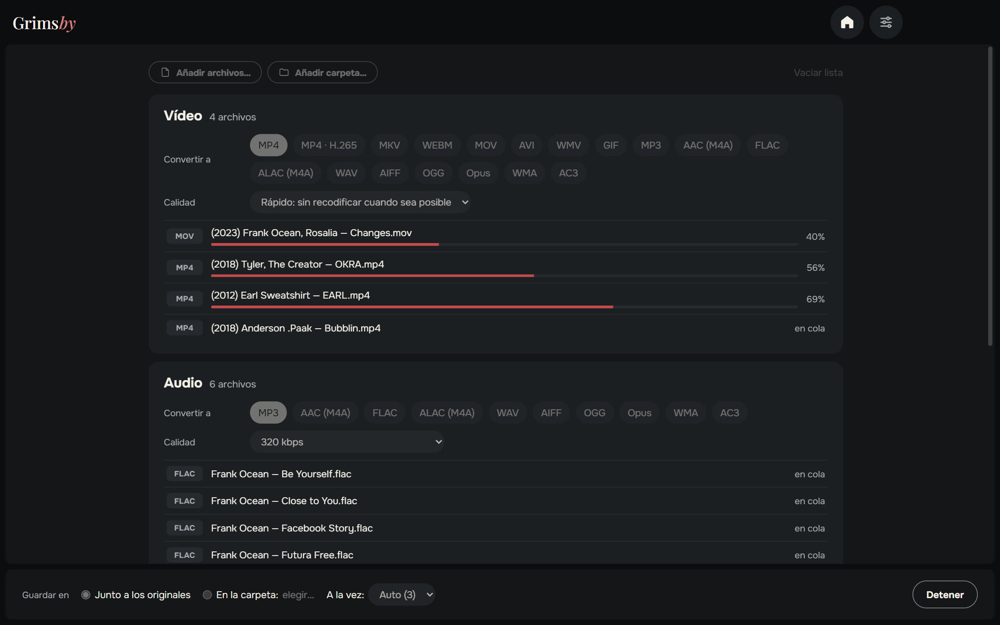
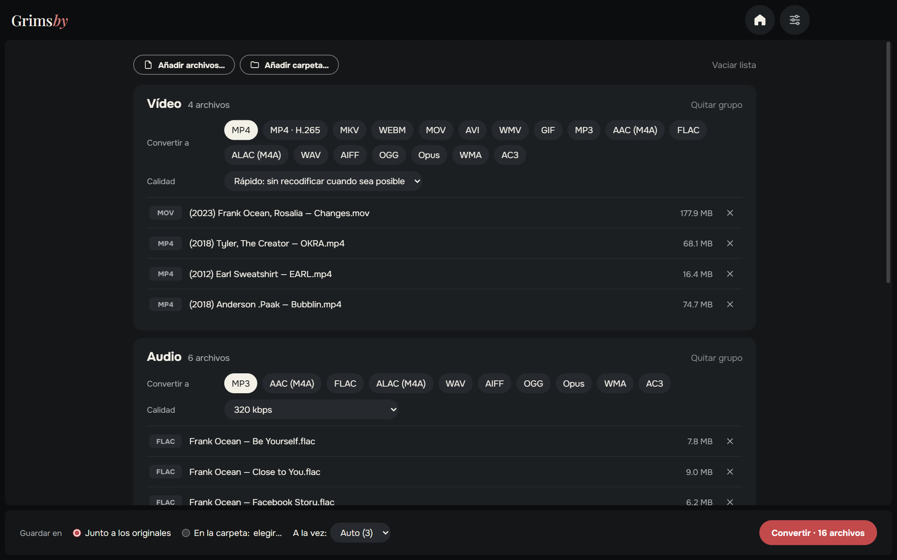
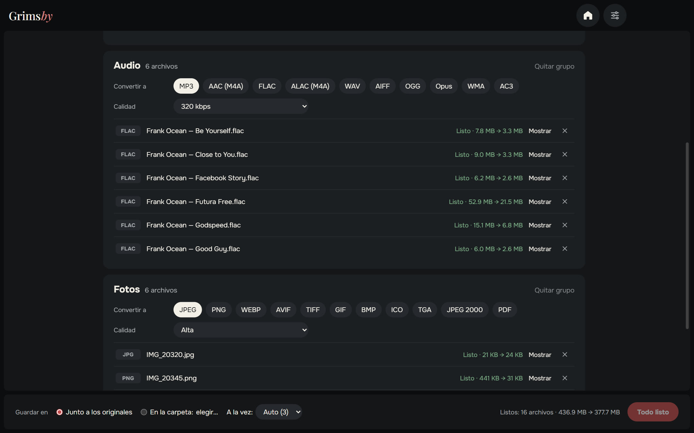
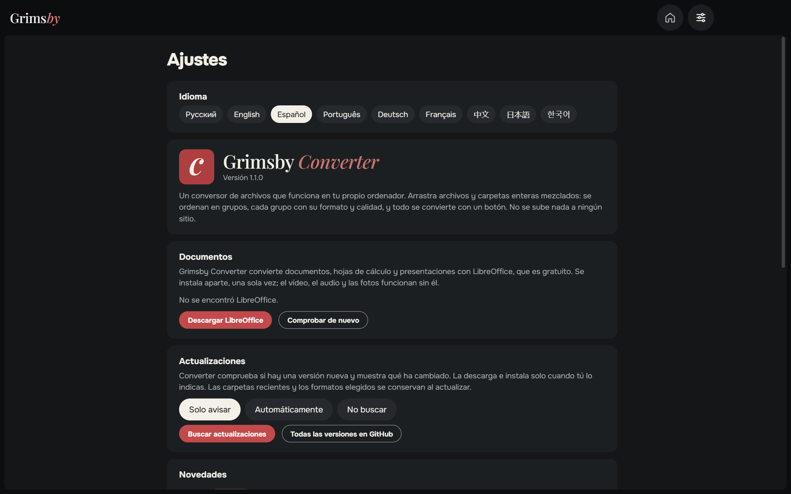
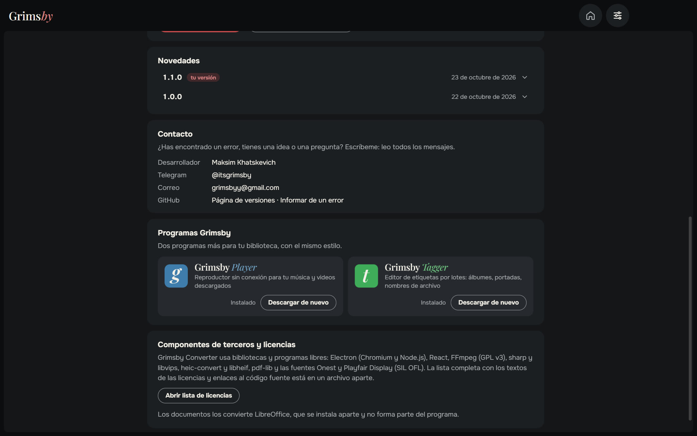
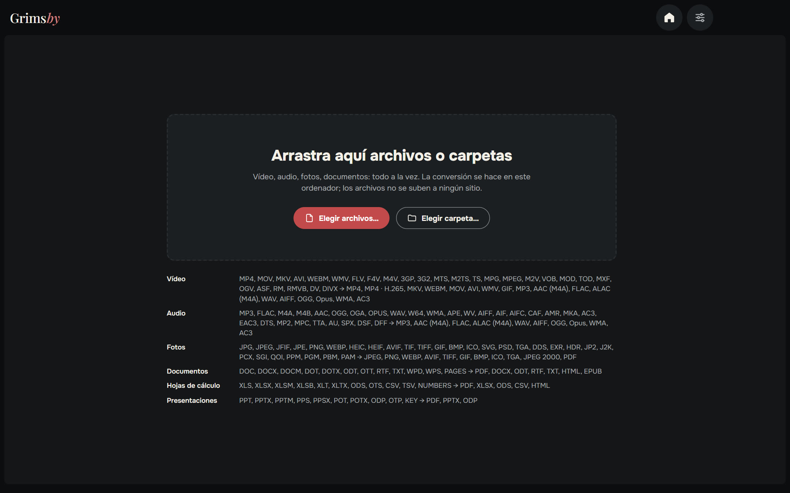

  <a href="README.md">English</a> ·
  <a href="README.ru.md">Русский</a> ·
  <b>Español</b> ·
  <a href="README.pt.md">Português</a> ·
  <a href="README.de.md">Deutsch</a> ·
  <a href="README.fr.md">Français</a> ·
  <a href="README.zh.md">中文</a> ·
  <a href="README.ja.md">日本語</a> ·
  <a href="README.ko.md">한국어</a>

  

  <b>Convierte video, audio, fotos y documentos, todo a la vez y en tu propio ordenador.</b> 
  No se sube nada a ningún sitio: sin colas en webs, sin límites de tamaño, sin marcas de agua.

  
  
  
  
  

  <a href="https://github.com/maksimkhatskevich/grimsby-converter/releases/latest"><b>⬇ Descargar para Windows</b></a>
  &nbsp;·&nbsp;
  <a href="#funciones">Funciones</a>
  &nbsp;·&nbsp;
  <a href="#formatos">Formatos</a>
  &nbsp;·&nbsp;
  <a href="#contacto">Contacto</a>

---

## Por qué Grimsby Converter

¿Necesitas un álbum FLAC en MP3 para el móvil, un MOV del iPhone en MP4, fotos HEIC en JPG y un DOCX en PDF? Normalmente eso son cuatro webs distintas, subir archivos privados al servidor de otro y esperar en cola.

**Grimsby Converter lo hace en una sola ventana.** Arrastra archivos y carpetas mezclados: se ordenan en grupos y cada grupo tiene su formato y calidad. Un botón, y todo se convierte en tu ordenador.

| | Conversores en línea | **Grimsby Converter** |
|---|:---:|:---:|
| Los archivos se quedan en tu ordenador | ✕ | **✓** |
| Sin límites de tamaño ni colas | ✕ | **✓** |
| Video, audio, fotos y documentos en un solo lugar | a veces | **✓** |
| Carpetas enteras de una vez | ✕ | **✓** |
| Funciona sin internet | ✕ | **✓** |
| Sin anuncios, marcas de agua ni registro | a veces | **✓** |

---

## Funciones

### 📥 Todo de una vez

Arrastra a la ventana archivos o carpetas enteras: video, música, fotos y documentos mezclados. Grimsby los ordena en grupos por tipo y muestra cuántos archivos hay en cada uno.

### 🎚 Cada grupo con sus ajustes

Elige el formato y la calidad para cada grupo: por ejemplo, video a MP4, música a MP3 320 kbps, fotos a WEBP.

- **Video — modo «Rápido»:** si el códec cabe en el nuevo contenedor, el video solo se reempaqueta (MOV → MP4 en segundos, sin perder calidad). Si no, o si el formato no lo abren muchos reproductores, se recodifica. **MP4 · H.265** deja el archivo a la mitad de tamaño.
- **Audio:** de MP3 y FLAC a DSD, DTS y audiolibros M4B; guarda también en ALAC, AIFF, WMA y más. Las etiquetas pasan a los archivos nuevos.
- **Fotos:** HEIC del iPhone, PSD de Photoshop, EXR, HDR, AVIF, SVG: todo se abre y se guarda en formatos habituales, incluso en PDF.
- **Documentos, hojas de cálculo, presentaciones** → PDF, DOCX, XLSX, EPUB y más; también abre archivos de Pages, Numbers y Keynote.

### ⚡ Rápido y seguro

- Varios archivos a la vez, tantos como aguante tu procesador.
- **Los originales no se tocan.** El archivo nuevo se escribe junto al original (o en la carpeta que elijas) y aparece solo cuando está listo del todo.
- En cada archivo terminado ves cuánto espacio se ahorró, y el botón «Mostrar» lo abre en el Explorador.
- Todo lo necesario para video, audio y fotos ya viene dentro: no hay que instalar nada más.

### ⚙️ Ajustes en una sola página

Idioma, documentos, actualizaciones (solo avisar, automáticas o no comprobar), novedades y contacto, todo en una página. La ventana recuerda su tamaño y posición.

🌍 **9 idiomas:** inglés, ruso, español, portugués, alemán, francés, chino, japonés y coreano; se cambian en Ajustes al instante.

### 🧩 Las apps de Grimsby dentro

Grimsby Player y Grimsby Tagger con descripción y capturas: descárgalos e instálalos desde la propia app.

---

## Formatos

| Grupo | Abre | Guarda en |
|---|---|---|
| 🎬 Video | MP4, MOV, MKV, AVI, WEBM, WMV, FLV, F4V, M4V, 3GP, 3G2, MTS, M2TS, TS, MPG, MPEG, M2V, VOB, MOD, TOD, MXF, OGV, ASF, RM, RMVB, DV, DIVX | MP4, MP4 · H.265, MKV, WEBM, MOV, AVI, WMV, GIF; solo sonido → MP3, AAC (M4A), FLAC, ALAC (M4A), WAV, AIFF, OGG, Opus, WMA, AC3 |
| 🎵 Audio | MP3, FLAC, M4A, M4B, AAC, OGG, OGA, OPUS, WAV, W64, WMA, APE, WV, AIFF, AIF, AIFC, CAF, AMR, MKA, AC3, EAC3, DTS, MP2, MPC, TTA, AU, SPX, DSF, DFF | MP3, AAC (M4A), FLAC, ALAC (M4A), WAV, AIFF, OGG, Opus, WMA, AC3 |
| 🖼 Fotos | JPG, JPEG, JFIF, PNG, WEBP, HEIC, HEIF, AVIF, TIF, TIFF, GIF, BMP, ICO, SVG, PSD, TGA, DDS, EXR, HDR, JP2, J2K, PCX, SGI, QOI, PPM, PGM, PBM, PAM | JPEG, PNG, WEBP, AVIF, TIFF, GIF, BMP, ICO, TGA, JPEG 2000, PDF |
| 📄 Documentos | DOC, DOCX, DOCM, DOT, DOTX, ODT, OTT, RTF, TXT, WPD, WPS, PAGES | PDF, DOCX, ODT, RTF, TXT, HTML, EPUB |
| 📊 Hojas de cálculo | XLS, XLSX, XLSM, XLSB, XLT, XLTX, ODS, OTS, CSV, TSV, NUMBERS | PDF, XLSX, ODS, CSV, HTML |
| 📽 Presentaciones | PPT, PPTX, PPTM, PPS, PPSX, POT, POTX, ODP, OTP, KEY | PDF, PPTX, ODP |

> Los documentos, hojas de cálculo y presentaciones se convierten con la suite gratuita **LibreOffice**. Si no está instalada, Grimsby te ofrecerá descargarla. Video, audio y fotos funcionan al momento.

---

## Descargar e instalar

1. Abre la página de la **[última versión](https://github.com/maksimkhatskevich/grimsby-converter/releases/latest)** y descarga el instalador `.exe`.
2. Ejecútalo. Windows puede mostrar una ventana azul «Windows protegió su PC»: es un aviso normal para programas sin certificado de firma de pago. Pulsa **Más información → Ejecutar de todas formas**.
   El instalador se ha analizado en VirusTotal: [ninguno de 67 antivirus detecta nada](https://www.virustotal.com/gui/file/caeade773641b7b2a15fcc427afa02305a45262004d60aade01427700477fd3b) (versión 1.1.0).
3. Arrastra tus archivos a la ventana. Listo.

**Requisitos:** Windows 10 u 11 (64 bits).

---

## Privacidad

Grimsby Converter funciona **por completo en tu ordenador**. Los archivos no se suben a ningún sitio. Sin cuentas, sin anuncios, sin analíticas.

---

## Las apps de Grimsby

<table>
  <tr>
    <td align="center" width="33%"><a href="https://github.com/maksimkhatskevich/grimsby-releases/blob/main/README.es.md"> <b>Grimsby Player</b></a> Reproductor sin conexión para tu música y videos descargados</td>
    <td align="center" width="33%"> <b>Grimsby Converter</b> </td>
    <td align="center" width="33%"><a href="https://github.com/maksimkhatskevich/grimsby-tagger/blob/main/README.es.md"> <b>Grimsby Tagger</b></a> Editor de etiquetas por lotes: álbumes, portadas, nombres de archivo</td>
  </tr>
</table>

---

## Contacto

¿Encontraste un error, tienes una idea o solo quieres dar las gracias? Escríbeme:

- ✉️ correo: **[grimsbyy@gmail.com](mailto:grimsbyy@gmail.com)**
- 🐞 errores e ideas: [Issues](https://github.com/maksimkhatskevich/grimsby-converter/issues)
- 📣 Telegram: [@itsgrimsby](https://t.me/itsgrimsby) (en ruso)

---

## Licencias

Grimsby Converter usa componentes de código abierto, entre ellos Electron, React, FFmpeg (GPL v3) y libvips. La lista completa con los textos de las licencias está en la app: Ajustes → Abrir la lista de licencias.

© 2026 Grimsby

