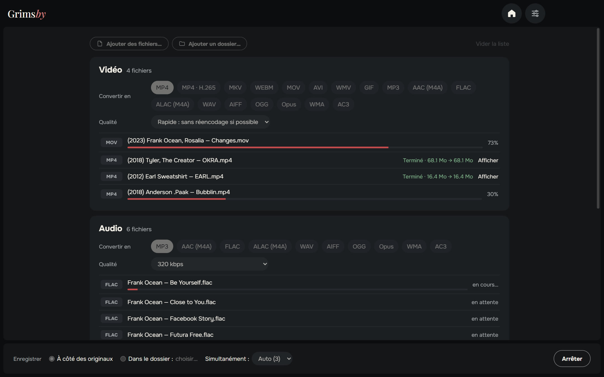
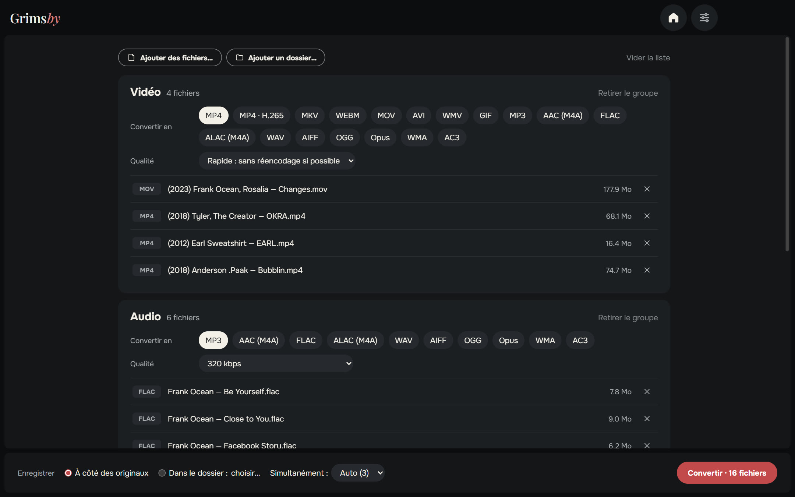
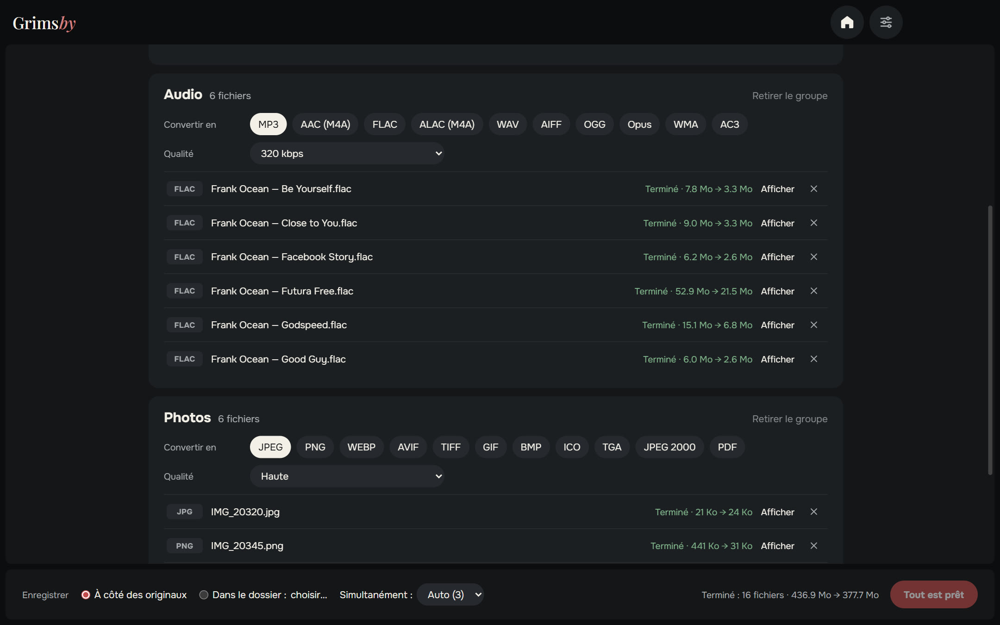
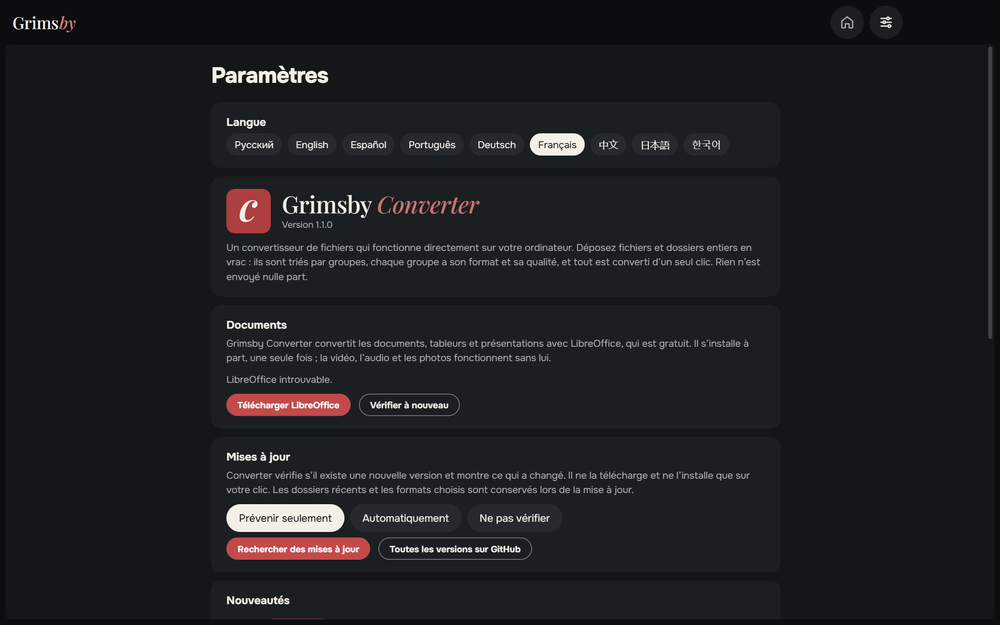
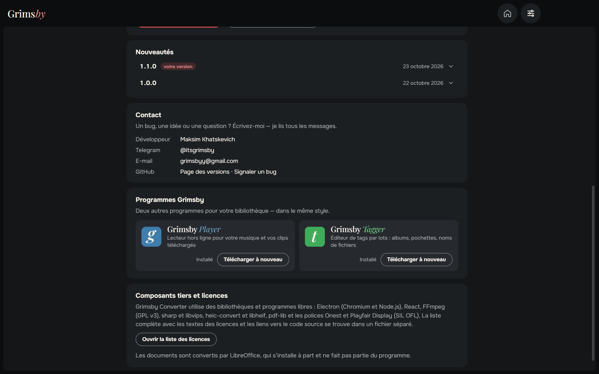
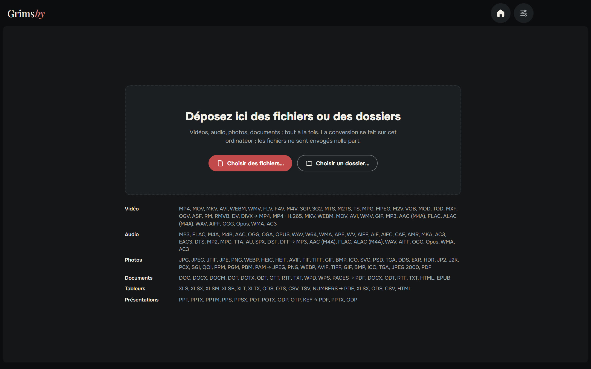

  <a href="README.md">English</a> ·
  <a href="README.ru.md">Русский</a> ·
  <a href="README.es.md">Español</a> ·
  <a href="README.pt.md">Português</a> ·
  <a href="README.de.md">Deutsch</a> ·
  <b>Français</b> ·
  <a href="README.zh.md">中文</a> ·
  <a href="README.ja.md">日本語</a> ·
  <a href="README.ko.md">한국어</a>

  

  <b>Convertissez vidéo, audio, photos et documents — tout à la fois, directement sur votre PC.</b> 
  Rien n’est envoyé nulle part : pas de file d’attente en ligne, pas de limite de taille, pas de filigrane.

  
  
  
  
  

  <a href="https://github.com/maksimkhatskevich/grimsby-converter/releases/latest"><b>⬇ Télécharger pour Windows</b></a>
  &nbsp;·&nbsp;
  <a href="#fonctionnalités">Fonctionnalités</a>
  &nbsp;·&nbsp;
  <a href="#formats">Formats</a>
  &nbsp;·&nbsp;
  <a href="#contact">Contact</a>

---

## Pourquoi Grimsby Converter

Un album FLAC en MP3 pour le téléphone, un MOV d’iPhone en MP4, des photos HEIC en JPG et un DOCX en PDF ? D’habitude, c’est quatre sites différents, des fichiers personnels envoyés sur le serveur de quelqu’un d’autre et de l’attente.

**Grimsby Converter fait tout dans une seule fenêtre.** Déposez fichiers et dossiers en vrac : ils sont triés par groupes, chacun avec son format et sa qualité. Un clic, et tout est converti sur votre ordinateur.

| | Convertisseurs en ligne | **Grimsby Converter** |
|---|:---:|:---:|
| Les fichiers restent sur votre ordinateur | ✕ | **✓** |
| Pas de limite de taille ni d’attente | ✕ | **✓** |
| Vidéo, audio, photos et documents au même endroit | rarement | **✓** |
| Des dossiers entiers d’un coup | ✕ | **✓** |
| Fonctionne sans internet | ✕ | **✓** |
| Sans pub, sans filigrane, sans inscription | rarement | **✓** |

---

## Fonctionnalités

### 📥 Tout déposer d’un coup

Glissez dans la fenêtre des fichiers ou des dossiers entiers — vidéo, musique, photos et documents mélangés. Grimsby les trie par type et indique combien de fichiers compte chaque groupe.

### 🎚 Des réglages pour chaque groupe

Choisissez le format et la qualité par groupe : par exemple, la vidéo en MP4, la musique en MP3 320 kbit/s, les photos en WEBP.

- **Vidéo — mode « Rapide » :** si le codec convient au nouveau conteneur, la vidéo est simplement réempaquetée (MOV → MP4 en quelques secondes, sans perte de qualité). Sinon — ou si beaucoup de lecteurs ne lisent pas ce format — elle est réencodée. **MP4 · H.265** divise la taille du fichier par deux environ.
- **Audio :** du MP3 et du FLAC jusqu’au DSD, DTS et livres audio M4B ; enregistre aussi en ALAC, AIFF, WMA et plus. Les tags sont conservés.
- **Photos :** HEIC de l’iPhone, PSD de Photoshop, EXR, HDR, AVIF, SVG — tout s’ouvre et s’enregistre dans les formats courants, même en PDF.
- **Documents, tableurs, présentations** → PDF, DOCX, XLSX, EPUB et plus ; les fichiers Pages, Numbers et Keynote s’ouvrent aussi.

### ⚡ Rapide et sûr

- Plusieurs fichiers à la fois — autant que votre processeur le permet.
- **Les originaux restent intacts.** Le nouveau fichier est écrit à côté de l’original (ou dans le dossier choisi) et n’apparaît qu’une fois terminé.
- Pour chaque fichier terminé, vous voyez l’espace gagné, et le bouton « Afficher » l’ouvre dans l’Explorateur.
- Tout le nécessaire pour la vidéo, l’audio et les photos est déjà inclus — rien d’autre à installer.

### ⚙️ Réglages sur une seule page

Langue, documents, mises à jour (prévenir seulement, automatiquement ou ne pas vérifier), nouveautés et contact — tout sur une page. La fenêtre retient sa taille et sa position.

🌍 **9 langues :** anglais, russe, espagnol, portugais, allemand, français, chinois, japonais et coréen — à changer dans les Réglages, effet immédiat.

### 🧩 Les applis Grimsby intégrées

Grimsby Player et Grimsby Tagger avec description et captures — à télécharger et installer directement depuis l’appli.

---

## Formats

| Groupe | Ouvre | Enregistre en |
|---|---|---|
| 🎬 Vidéo | MP4, MOV, MKV, AVI, WEBM, WMV, FLV, F4V, M4V, 3GP, 3G2, MTS, M2TS, TS, MPG, MPEG, M2V, VOB, MOD, TOD, MXF, OGV, ASF, RM, RMVB, DV, DIVX | MP4, MP4 · H.265, MKV, WEBM, MOV, AVI, WMV, GIF; son seul → MP3, AAC (M4A), FLAC, ALAC (M4A), WAV, AIFF, OGG, Opus, WMA, AC3 |
| 🎵 Audio | MP3, FLAC, M4A, M4B, AAC, OGG, OGA, OPUS, WAV, W64, WMA, APE, WV, AIFF, AIF, AIFC, CAF, AMR, MKA, AC3, EAC3, DTS, MP2, MPC, TTA, AU, SPX, DSF, DFF | MP3, AAC (M4A), FLAC, ALAC (M4A), WAV, AIFF, OGG, Opus, WMA, AC3 |
| 🖼 Photos | JPG, JPEG, JFIF, PNG, WEBP, HEIC, HEIF, AVIF, TIF, TIFF, GIF, BMP, ICO, SVG, PSD, TGA, DDS, EXR, HDR, JP2, J2K, PCX, SGI, QOI, PPM, PGM, PBM, PAM | JPEG, PNG, WEBP, AVIF, TIFF, GIF, BMP, ICO, TGA, JPEG 2000, PDF |
| 📄 Documents | DOC, DOCX, DOCM, DOT, DOTX, ODT, OTT, RTF, TXT, WPD, WPS, PAGES | PDF, DOCX, ODT, RTF, TXT, HTML, EPUB |
| 📊 Tableurs | XLS, XLSX, XLSM, XLSB, XLT, XLTX, ODS, OTS, CSV, TSV, NUMBERS | PDF, XLSX, ODS, CSV, HTML |
| 📽 Présentations | PPT, PPTX, PPTM, PPS, PPSX, POT, POTX, ODP, OTP, KEY | PDF, PPTX, ODP |

> Les documents, tableurs et présentations sont convertis avec la suite gratuite **LibreOffice**. Si elle n’est pas installée, Grimsby propose de la télécharger. Vidéo, audio et photos fonctionnent tout de suite.

---

## Télécharger et installer

1. Ouvrez la page de la **[dernière version](https://github.com/maksimkhatskevich/grimsby-converter/releases/latest)** et téléchargez l’installeur `.exe`.
2. Lancez-le. Windows peut afficher une fenêtre bleue « Windows a protégé votre ordinateur » : c’est un avertissement normal pour les logiciels sans certificat de signature payant. Cliquez sur **Informations complémentaires → Exécuter quand même**.
   L’installeur a été vérifié sur VirusTotal : [aucun des 67 antivirus ne détecte quoi que ce soit](https://www.virustotal.com/gui/file/caeade773641b7b2a15fcc427afa02305a45262004d60aade01427700477fd3b) (version 1.1.0).
3. Déposez vos fichiers dans la fenêtre. C’est tout.

**Configuration requise :** Windows 10 ou 11 (64 bits).

---

## Confidentialité

Grimsby Converter fonctionne **entièrement sur votre ordinateur**. Les fichiers ne sont envoyés nulle part. Pas de compte, pas de pub, pas de statistiques.

---

## Les applis Grimsby

<table>
  <tr>
    <td align="center" width="33%"><a href="https://github.com/maksimkhatskevich/grimsby-releases/blob/main/README.fr.md"> <b>Grimsby Player</b></a> Lecteur hors ligne pour votre musique et vos clips téléchargés</td>
    <td align="center" width="33%"> <b>Grimsby Converter</b> </td>
    <td align="center" width="33%"><a href="https://github.com/maksimkhatskevich/grimsby-tagger/blob/main/README.fr.md"> <b>Grimsby Tagger</b></a> Éditeur de tags par lots : albums, pochettes, noms de fichiers</td>
  </tr>
</table>

---

## Contact

Un bug, une idée ou juste envie de dire merci ? Écrivez-moi :

- ✉️ e-mail: **[grimsbyy@gmail.com](mailto:grimsbyy@gmail.com)**
- 🐞 bugs et idées: [Issues](https://github.com/maksimkhatskevich/grimsby-converter/issues)
- 📣 Telegram : [@itsgrimsby](https://t.me/itsgrimsby) (en russe)

---

## Licences

Grimsby Converter utilise des composants open source, dont Electron, React, FFmpeg (GPL v3) et libvips. La liste complète avec les textes des licences est dans l’appli : Réglages → Ouvrir la liste des licences.

© 2026 Grimsby

