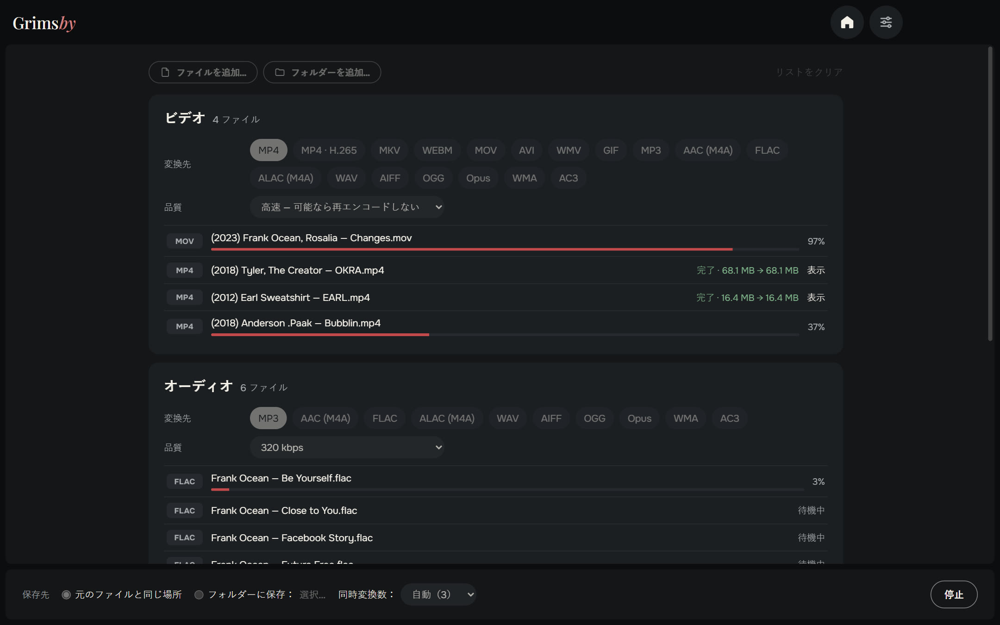
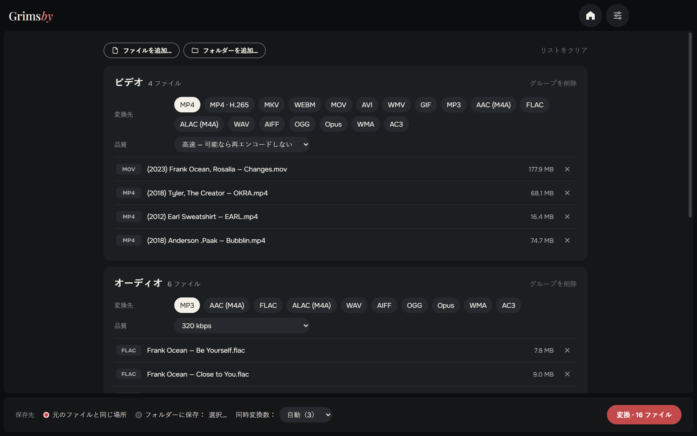
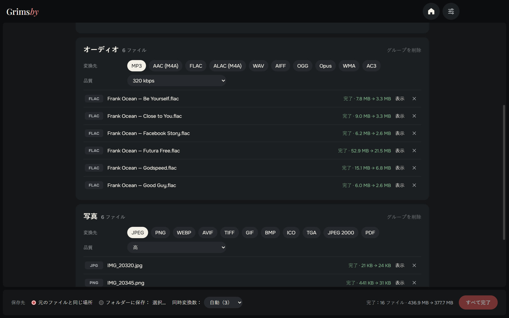
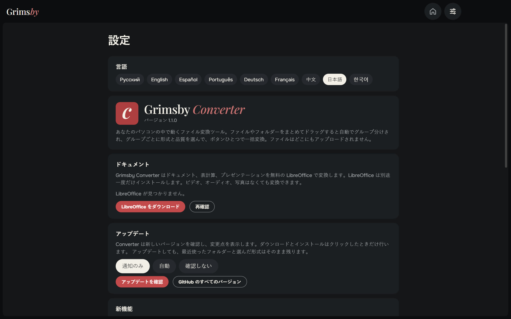
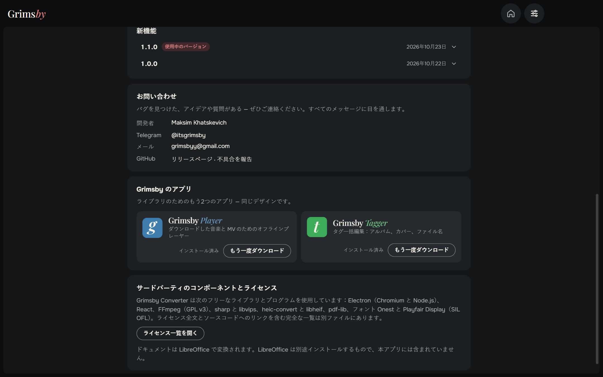
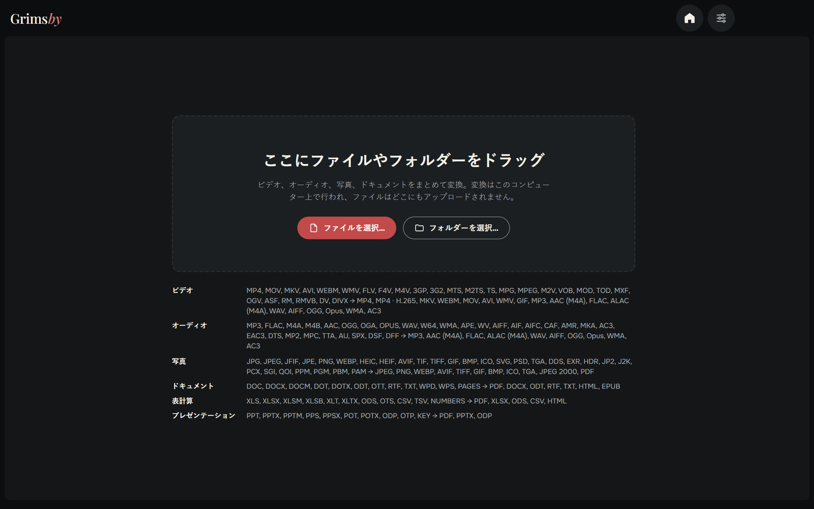

  <a href="README.md">English</a> ·
  <a href="README.ru.md">Русский</a> ·
  <a href="README.es.md">Español</a> ·
  <a href="README.pt.md">Português</a> ·
  <a href="README.de.md">Deutsch</a> ·
  <a href="README.fr.md">Français</a> ·
  <a href="README.zh.md">中文</a> ·
  <b>日本語</b> ·
  <a href="README.ko.md">한국어</a>

  

  <b>動画・音声・写真・文書を、まとめてあなたのパソコンで変換。</b> 
  ファイルはどこにもアップロードされません。順番待ちもサイズ制限もウォーターマークもなし。

  
  
  
  
  

  <a href="https://github.com/maksimkhatskevich/grimsby-converter/releases/latest"><b>⬇ Windows 版をダウンロード</b></a>
  &nbsp;·&nbsp;
  <a href="#機能">機能</a>
  &nbsp;·&nbsp;
  <a href="#対応形式">対応形式</a>
  &nbsp;·&nbsp;
  <a href="#お問い合わせ">お問い合わせ</a>

---

## Grimsby Converter を選ぶ理由

FLAC のアルバムをスマホ用に MP3 へ、iPhone の MOV を MP4 へ、HEIC 写真を JPG へ、DOCX を PDF へ——いつもなら 4 つのサイトを回り、個人のファイルを他人のサーバーにアップロードして順番を待つことになります。

**Grimsby Converter ならひとつの画面で完了。** ファイルやフォルダーをまとめてドラッグすると自動でグループ分けされ、グループごとに形式と品質を設定。ボタンひとつで、すべてあなたのパソコンの中で変換されます。

| | オンライン変換サービス | **Grimsby Converter** |
|---|:---:|:---:|
| ファイルは手元のパソコンに残る | ✕ | **✓** |
| サイズ制限も順番待ちもなし | ✕ | **✓** |
| 動画・音声・写真・文書をひとつの場所で | まれ | **✓** |
| フォルダーごとまとめて変換 | ✕ | **✓** |
| インターネットなしで動作 | ✕ | **✓** |
| 広告・ウォーターマーク・登録なし | まれ | **✓** |

---

## 機能

### 📥 まとめてドロップ

ファイルやフォルダーを画面にドラッグするだけ。動画、音楽、写真、文書が混ざっていても大丈夫。種類ごとにグループ分けし、それぞれのファイル数を表示します。

### 🎚 グループごとに設定

変換先の形式と品質はグループ単位で選べます。たとえば動画は MP4、音楽は MP3 320 kbps、写真は WEBP。

- **動画の「高速」モード：** コーデックが新しいコンテナに合えば、再エンコードせずに詰め替えるだけ（MOV → MP4 が数秒、画質の劣化なし）。合わない場合や多くのプレーヤーで開けない形式の場合は再エンコードします。**MP4 · H.265** ならファイルサイズはおよそ半分。
- **音声：** MP3 や FLAC から DSD、DTS、M4B のオーディオブックまで。ALAC、AIFF、WMA などにも保存できます。タグは新しいファイルに引き継がれます。
- **写真：** iPhone の HEIC、Photoshop の PSD、EXR、HDR、AVIF、SVG もすべて開いて一般的な形式に保存。PDF にも。
- **文書・表計算・プレゼン** → PDF、DOCX、XLSX、EPUB など。Pages、Numbers、Keynote のファイルも開けます。

### ⚡ 速くて安全

- 複数のファイルを同時に変換。プロセッサーの性能に合わせて並列処理します。
- **元のファイルはそのまま。** 新しいファイルは元のファイルの隣（または選んだフォルダー）に書き出され、完成してから表示されます。
- 変換が終わったファイルごとに節約できた容量が表示され、「表示」でエクスプローラーで開けます。
- 動画・音声・写真に必要なものはすべて内蔵。追加のインストールは不要です。

### ⚙️ 設定はひとつのページに

言語、文書、アップデート（通知のみ・自動・確認しない）、更新内容、お問い合わせをひとつのページに。ウィンドウのサイズと位置も記憶します。

🌍 **9 言語：** 英語、ロシア語、スペイン語、ポルトガル語、ドイツ語、フランス語、中国語、日本語、韓国語。設定で切り替えるとすぐに反映されます。

### 🧩 Grimsby のアプリも

Grimsby Player と Grimsby Tagger の説明とスクリーンショット。アプリから直接ダウンロードしてインストールできます。

---

## 対応形式

| 種類 | 開ける形式 | 保存できる形式 |
|---|---|---|
| 🎬 動画 | MP4, MOV, MKV, AVI, WEBM, WMV, FLV, F4V, M4V, 3GP, 3G2, MTS, M2TS, TS, MPG, MPEG, M2V, VOB, MOD, TOD, MXF, OGV, ASF, RM, RMVB, DV, DIVX | MP4, MP4 · H.265, MKV, WEBM, MOV, AVI, WMV, GIF; 音声のみ → MP3, AAC (M4A), FLAC, ALAC (M4A), WAV, AIFF, OGG, Opus, WMA, AC3 |
| 🎵 音声 | MP3, FLAC, M4A, M4B, AAC, OGG, OGA, OPUS, WAV, W64, WMA, APE, WV, AIFF, AIF, AIFC, CAF, AMR, MKA, AC3, EAC3, DTS, MP2, MPC, TTA, AU, SPX, DSF, DFF | MP3, AAC (M4A), FLAC, ALAC (M4A), WAV, AIFF, OGG, Opus, WMA, AC3 |
| 🖼 写真 | JPG, JPEG, JFIF, PNG, WEBP, HEIC, HEIF, AVIF, TIF, TIFF, GIF, BMP, ICO, SVG, PSD, TGA, DDS, EXR, HDR, JP2, J2K, PCX, SGI, QOI, PPM, PGM, PBM, PAM | JPEG, PNG, WEBP, AVIF, TIFF, GIF, BMP, ICO, TGA, JPEG 2000, PDF |
| 📄 文書 | DOC, DOCX, DOCM, DOT, DOTX, ODT, OTT, RTF, TXT, WPD, WPS, PAGES | PDF, DOCX, ODT, RTF, TXT, HTML, EPUB |
| 📊 表計算 | XLS, XLSX, XLSM, XLSB, XLT, XLTX, ODS, OTS, CSV, TSV, NUMBERS | PDF, XLSX, ODS, CSV, HTML |
| 📽 プレゼン | PPT, PPTX, PPTM, PPS, PPSX, POT, POTX, ODP, OTP, KEY | PDF, PPTX, ODP |

> 文書・表計算・プレゼンは無料の **LibreOffice** で変換します。インストールされていなければ、Grimsby がダウンロードを案内します。動画・音声・写真はすぐに使えます。

---

## ダウンロードとインストール

1. **[最新バージョン](https://github.com/maksimkhatskevich/grimsby-converter/releases/latest)** のページを開き、インストーラー `.exe` をダウンロードします。
2. 実行します。Windows に青い「Windows によって PC が保護されました」画面が出ることがありますが、有料の署名証明書がないアプリでは普通の警告です。**詳細情報 → 実行** をクリックしてください。
   インストーラーは VirusTotal で確認済みです：[67 のウイルス対策エンジンすべてで検出なし](https://www.virustotal.com/gui/file/caeade773641b7b2a15fcc427afa02305a45262004d60aade01427700477fd3b)（バージョン 1.1.0）。
3. ファイルを画面にドラッグするだけ。これで完了です。

**動作環境：** Windows 10 / 11（64 ビット）。

---

## プライバシー

Grimsby Converter は **すべてあなたのパソコンの中で** 動きます。ファイルはどこにもアップロードされません。アカウントも広告も分析もありません。

---

## Grimsby のアプリ

<table>
  <tr>
    <td align="center" width="33%"><a href="https://github.com/maksimkhatskevich/grimsby-releases/blob/main/README.ja.md"> <b>Grimsby Player</b></a> ダウンロードした音楽と MV のためのオフラインプレーヤー</td>
    <td align="center" width="33%"> <b>Grimsby Converter</b> </td>
    <td align="center" width="33%"><a href="https://github.com/maksimkhatskevich/grimsby-tagger/blob/main/README.ja.md"> <b>Grimsby Tagger</b></a> タグ一括編集：アルバム、カバー、ファイル名</td>
  </tr>
</table>

---

## お問い合わせ

不具合を見つけた、アイデアがある、またはお礼を伝えたい？ご連絡ください：

- ✉️ メール: **[grimsbyy@gmail.com](mailto:grimsbyy@gmail.com)**
- 🐞 不具合とアイデア: [Issues](https://github.com/maksimkhatskevich/grimsby-converter/issues)
- 📣 Telegram：[@itsgrimsby](https://t.me/itsgrimsby)（ロシア語）

---

## ライセンス

Grimsby Converter は Electron、React、FFmpeg（GPL v3）、libvips などのオープンソースコンポーネントを使用しています。ライセンス本文を含む一覧はアプリ内の「設定 → ライセンス一覧を開く」から確認できます。

© 2026 Grimsby

