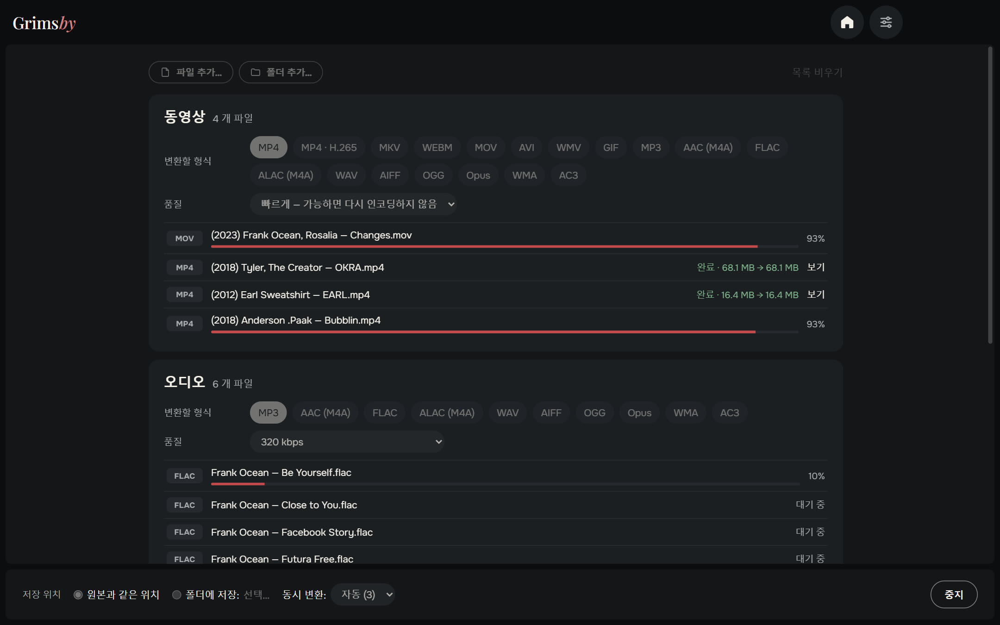
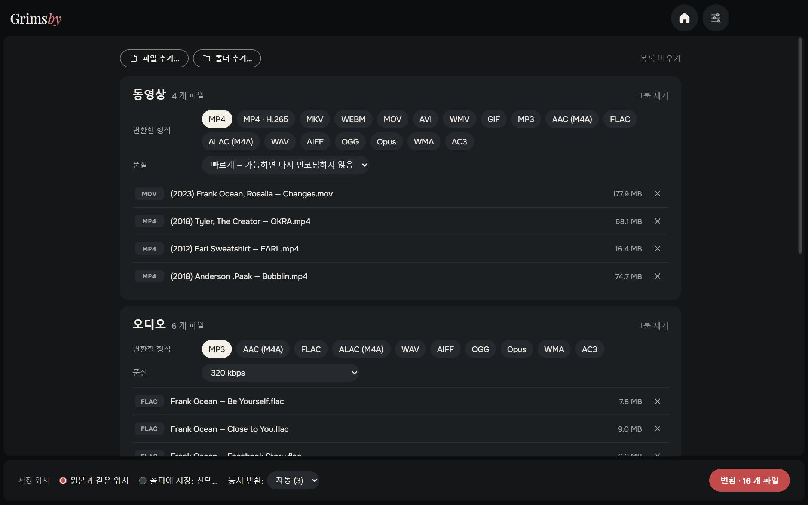
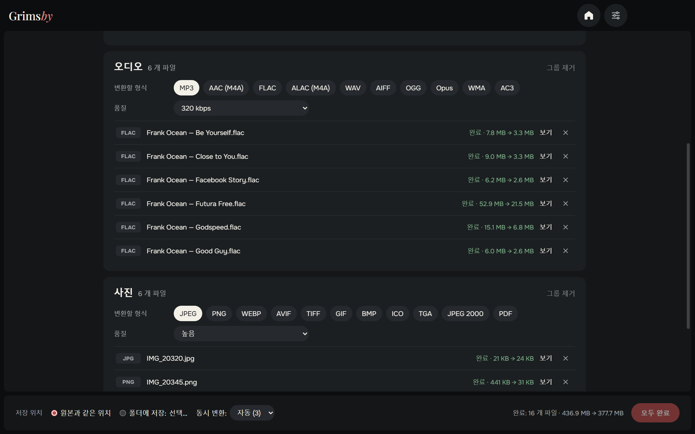
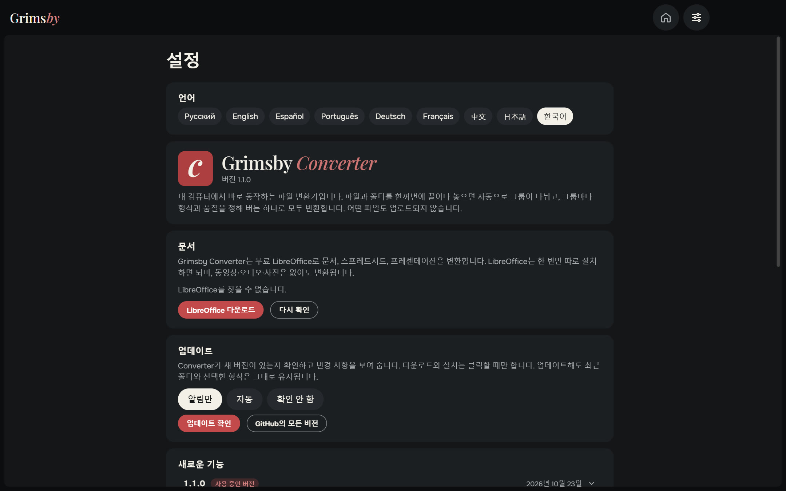
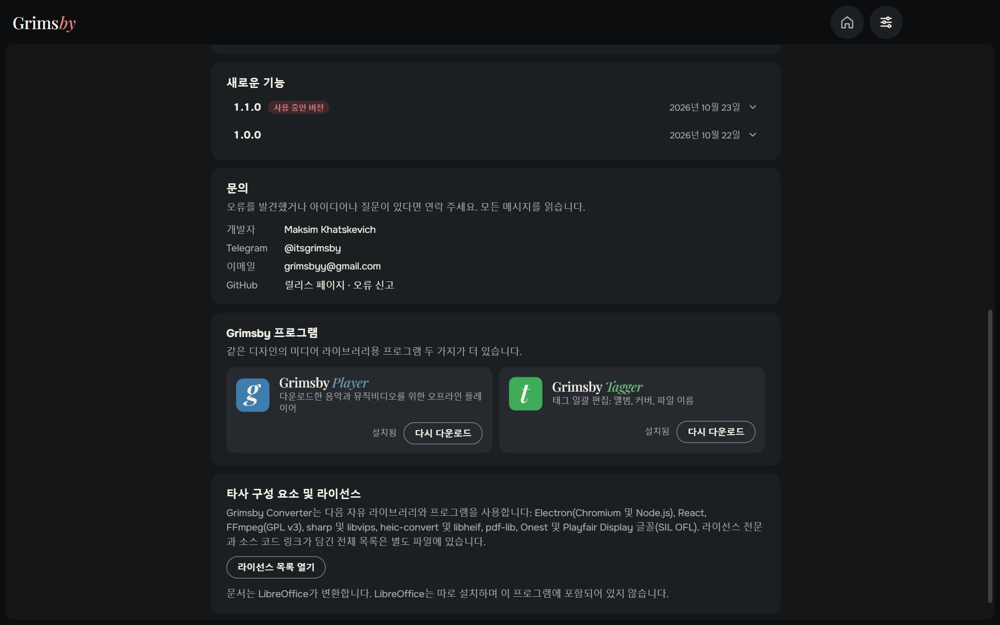
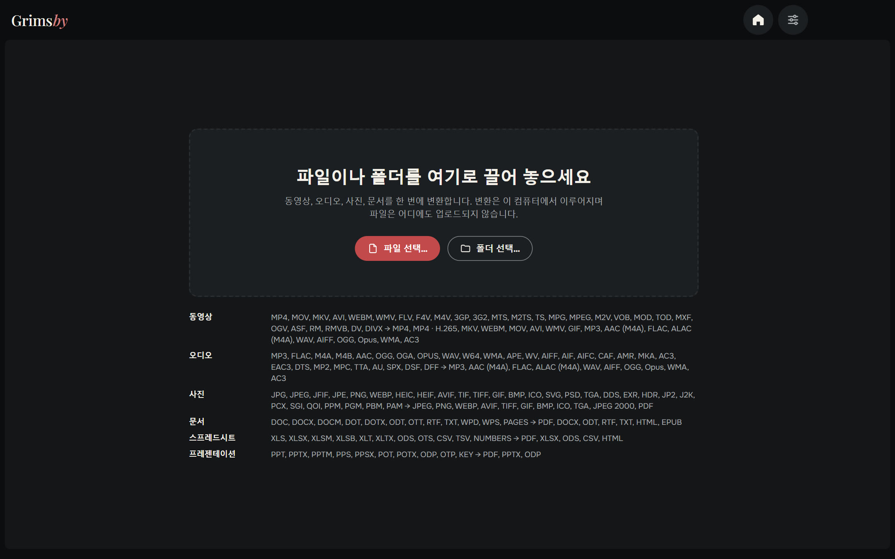

  <a href="README.md">English</a> ·
  <a href="README.ru.md">Русский</a> ·
  <a href="README.es.md">Español</a> ·
  <a href="README.pt.md">Português</a> ·
  <a href="README.de.md">Deutsch</a> ·
  <a href="README.fr.md">Français</a> ·
  <a href="README.zh.md">中文</a> ·
  <a href="README.ja.md">日本語</a> ·
  <b>한국어</b>

  

  <b>영상, 오디오, 사진, 문서를 한꺼번에, 내 PC에서 바로 변환하세요.</b> 
  아무것도 업로드되지 않습니다. 웹사이트 대기열도, 용량 제한도, 워터마크도 없습니다.

  
  
  
  
  

  <a href="https://github.com/maksimkhatskevich/grimsby-converter/releases/latest"><b>⬇ Windows용 다운로드</b></a>
  &nbsp;·&nbsp;
  <a href="#기능">기능</a>
  &nbsp;·&nbsp;
  <a href="#형식">형식</a>
  &nbsp;·&nbsp;
  <a href="#문의">문의</a>

---

## 왜 Grimsby Converter인가

FLAC 앨범을 휴대폰용 MP3로, 아이폰 MOV를 MP4로, HEIC 사진을 JPG로, DOCX를 PDF로 바꿔야 하나요? 보통은 사이트 네 곳을 돌며 개인 파일을 남의 서버에 올리고 차례를 기다려야 합니다.

**Grimsby Converter는 창 하나로 끝냅니다.** 파일과 폴더를 섞어서 끌어다 놓으면 자동으로 그룹이 나뉘고, 그룹마다 형식과 품질을 정할 수 있습니다. 버튼 하나면 모두 내 컴퓨터에서 변환됩니다.

| | 온라인 변환기 | **Grimsby Converter** |
|---|:---:|:---:|
| 파일이 내 컴퓨터에 그대로 | ✕ | **✓** |
| 용량 제한도 대기열도 없음 | ✕ | **✓** |
| 영상, 오디오, 사진, 문서를 한곳에서 | 드묾 | **✓** |
| 폴더째 한 번에 | ✕ | **✓** |
| 인터넷 없이 동작 | ✕ | **✓** |
| 광고, 워터마크, 가입 없음 | 드묾 | **✓** |

---

## 기능

### 📥 한 번에 끌어다 놓기

파일이나 폴더를 창에 끌어다 놓으세요. 영상, 음악, 사진, 문서가 섞여 있어도 됩니다. Grimsby가 종류별로 그룹을 나누고 각 그룹의 파일 수를 보여 줍니다.

### 🎚 그룹마다 따로 설정

그룹마다 변환 형식과 품질을 고르세요. 예를 들어 영상은 MP4, 음악은 MP3 320 kbps, 사진은 WEBP로.

- **영상 — "빠르게" 모드:** 코덱이 새 컨테이너에 맞으면 다시 포장만 합니다(MOV → MP4를 몇 초 만에, 화질 손실 없이). 맞지 않거나 많은 플레이어가 열지 못하는 형식이면 다시 인코딩합니다. **MP4 · H.265**는 파일 크기를 절반 정도로 줄여 줍니다.
- **오디오:** MP3와 FLAC부터 DSD, DTS, M4B 오디오북까지. ALAC, AIFF, WMA 등으로도 저장합니다. 태그는 새 파일로 옮겨집니다.
- **사진:** 아이폰 HEIC, 포토샵 PSD, EXR, HDR, AVIF, SVG까지 모두 열어 익숙한 형식으로 저장합니다. PDF로도요.
- **문서, 스프레드시트, 프레젠테이션** → PDF, DOCX, XLSX, EPUB 등. Pages, Numbers, Keynote 파일도 열립니다.

### ⚡ 빠르고 안전하게

- 여러 파일을 동시에 변환합니다 — 프로세서가 감당하는 만큼.
- **원본은 그대로입니다.** 새 파일은 원본 옆(또는 고른 폴더)에 만들어지고, 완전히 끝난 뒤에야 나타납니다.
- 완료된 파일마다 절약한 용량이 보이고, "보기" 버튼으로 탐색기에서 열 수 있습니다.
- 영상, 오디오, 사진에 필요한 것은 모두 들어 있어 따로 설치할 것이 없습니다.

### ⚙️ 설정은 한 페이지에

언어, 문서, 업데이트(알림만, 자동, 확인 안 함), 새 소식, 문의가 모두 한 페이지에. 창 크기와 위치도 기억합니다.

🌍 **9개 언어:** 영어, 러시아어, 스페인어, 포르투갈어, 독일어, 프랑스어, 중국어, 일본어, 한국어 — 설정에서 바꾸면 바로 적용됩니다.

### 🧩 Grimsby 앱도 함께

Grimsby Player와 Grimsby Tagger의 소개와 스크린샷 — 앱에서 바로 내려받아 설치할 수 있습니다.

---

## 형식

| 종류 | 여는 형식 | 저장 형식 |
|---|---|---|
| 🎬 영상 | MP4, MOV, MKV, AVI, WEBM, WMV, FLV, F4V, M4V, 3GP, 3G2, MTS, M2TS, TS, MPG, MPEG, M2V, VOB, MOD, TOD, MXF, OGV, ASF, RM, RMVB, DV, DIVX | MP4, MP4 · H.265, MKV, WEBM, MOV, AVI, WMV, GIF; 소리만 → MP3, AAC (M4A), FLAC, ALAC (M4A), WAV, AIFF, OGG, Opus, WMA, AC3 |
| 🎵 오디오 | MP3, FLAC, M4A, M4B, AAC, OGG, OGA, OPUS, WAV, W64, WMA, APE, WV, AIFF, AIF, AIFC, CAF, AMR, MKA, AC3, EAC3, DTS, MP2, MPC, TTA, AU, SPX, DSF, DFF | MP3, AAC (M4A), FLAC, ALAC (M4A), WAV, AIFF, OGG, Opus, WMA, AC3 |
| 🖼 사진 | JPG, JPEG, JFIF, PNG, WEBP, HEIC, HEIF, AVIF, TIF, TIFF, GIF, BMP, ICO, SVG, PSD, TGA, DDS, EXR, HDR, JP2, J2K, PCX, SGI, QOI, PPM, PGM, PBM, PAM | JPEG, PNG, WEBP, AVIF, TIFF, GIF, BMP, ICO, TGA, JPEG 2000, PDF |
| 📄 문서 | DOC, DOCX, DOCM, DOT, DOTX, ODT, OTT, RTF, TXT, WPD, WPS, PAGES | PDF, DOCX, ODT, RTF, TXT, HTML, EPUB |
| 📊 스프레드시트 | XLS, XLSX, XLSM, XLSB, XLT, XLTX, ODS, OTS, CSV, TSV, NUMBERS | PDF, XLSX, ODS, CSV, HTML |
| 📽 프레젠테이션 | PPT, PPTX, PPTM, PPS, PPSX, POT, POTX, ODP, OTP, KEY | PDF, PPTX, ODP |

> 문서, 스프레드시트, 프레젠테이션은 무료 **LibreOffice**로 변환합니다. 설치되어 있지 않으면 Grimsby가 다운로드를 안내합니다. 영상, 오디오, 사진은 바로 쓸 수 있습니다.

---

## 다운로드 및 설치

1. **[최신 버전](https://github.com/maksimkhatskevich/grimsby-converter/releases/latest)** 페이지를 열고 설치 프로그램 `.exe`를 다운로드하세요.
2. 실행하세요. Windows가 파란색 "Windows의 PC 보호" 창을 띄울 수 있는데, 유료 코드 서명 인증서가 없는 프로그램에 대한 일반적인 경고입니다. **추가 정보 → 실행**을 누르세요.
   설치 프로그램은 VirusTotal에서 검사했습니다: [백신 엔진 67개 모두 이상 없음](https://www.virustotal.com/gui/file/caeade773641b7b2a15fcc427afa02305a45262004d60aade01427700477fd3b) (버전 1.1.0).
3. 파일을 창에 끌어다 놓으세요. 끝입니다.

**요구 사항:** Windows 10 또는 11(64비트).

---

## 개인정보

Grimsby Converter는 **모두 내 컴퓨터 안에서** 동작합니다. 파일은 어디에도 업로드되지 않습니다. 계정도, 광고도, 분석도 없습니다.

---

## Grimsby 앱

<table>
  <tr>
    <td align="center" width="33%"><a href="https://github.com/maksimkhatskevich/grimsby-releases/blob/main/README.ko.md"> <b>Grimsby Player</b></a> 다운로드한 음악과 뮤직비디오를 위한 오프라인 플레이어</td>
    <td align="center" width="33%"> <b>Grimsby Converter</b> </td>
    <td align="center" width="33%"><a href="https://github.com/maksimkhatskevich/grimsby-tagger/blob/main/README.ko.md"> <b>Grimsby Tagger</b></a> 태그 일괄 편집: 앨범, 커버, 파일 이름</td>
  </tr>
</table>

---

## 문의

버그를 찾았거나, 아이디어가 있거나, 그냥 고맙다고 말하고 싶다면 연락 주세요:

- ✉️ 이메일: **[grimsbyy@gmail.com](mailto:grimsbyy@gmail.com)**
- 🐞 버그와 아이디어: [Issues](https://github.com/maksimkhatskevich/grimsby-converter/issues)
- 📣 Telegram: [@itsgrimsby](https://t.me/itsgrimsby) (러시아어)

---

## 라이선스

Grimsby Converter는 Electron, React, FFmpeg(GPL v3), libvips 등 오픈 소스 구성 요소를 사용합니다. 라이선스 전문이 담긴 전체 목록은 앱의 설정 → 라이선스 목록 열기에서 볼 수 있습니다.

© 2026 Grimsby

