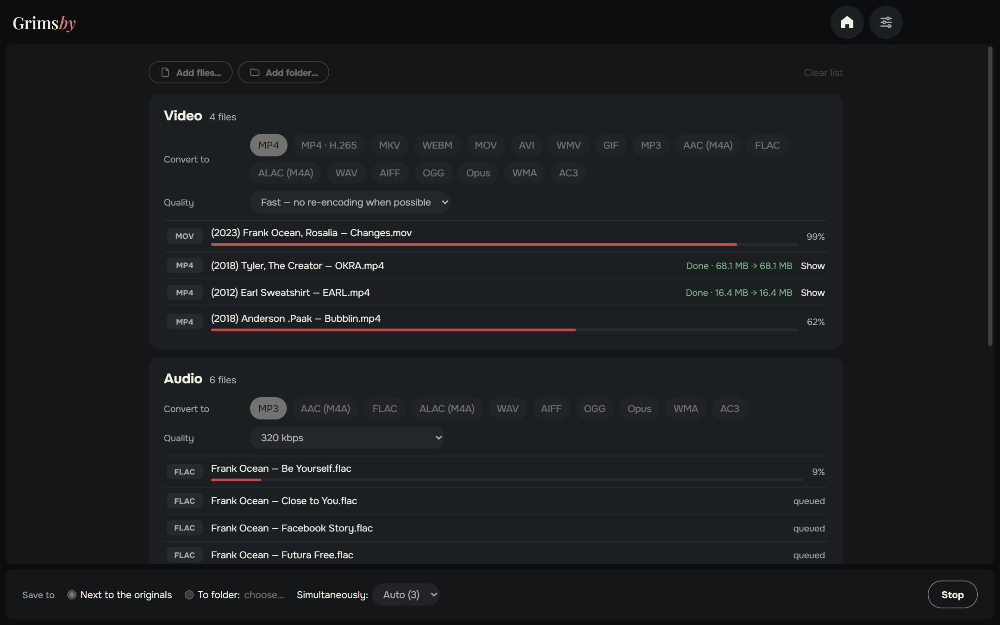
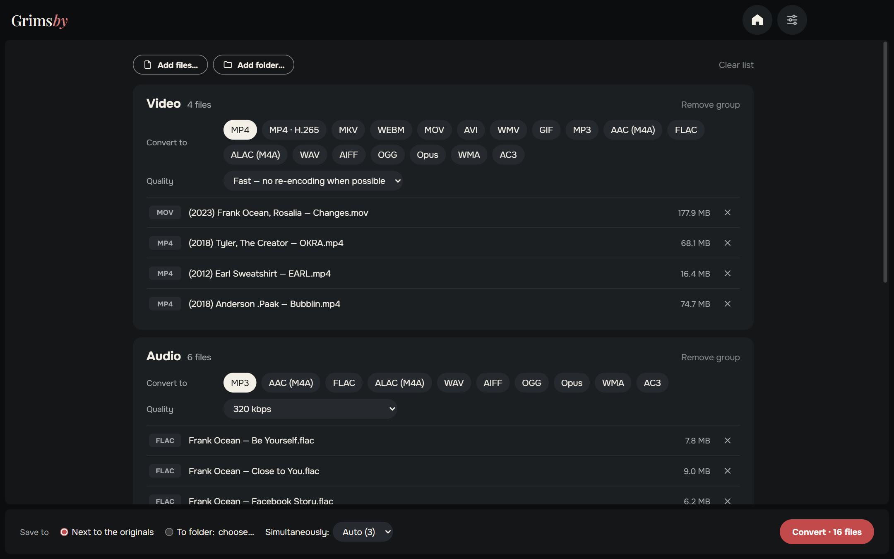
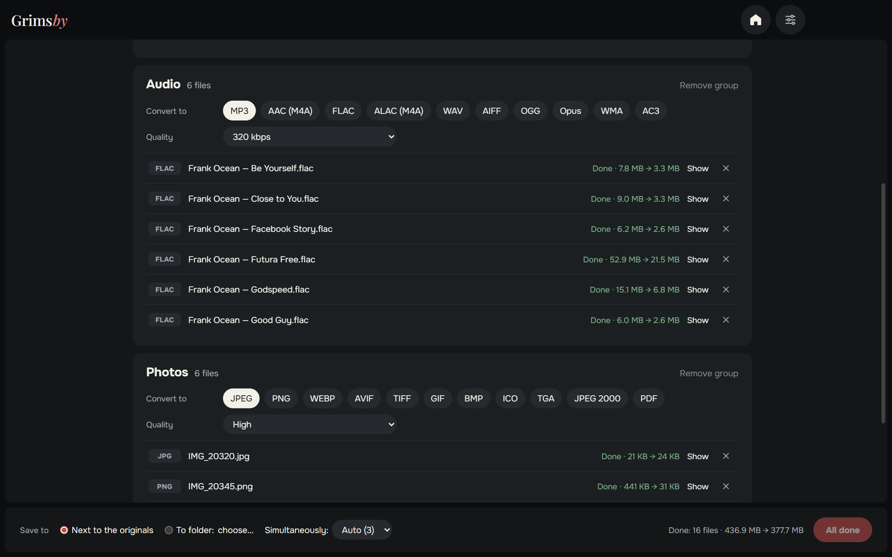
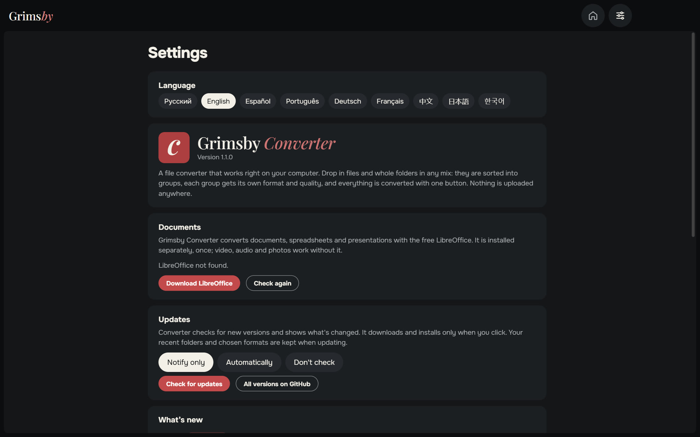
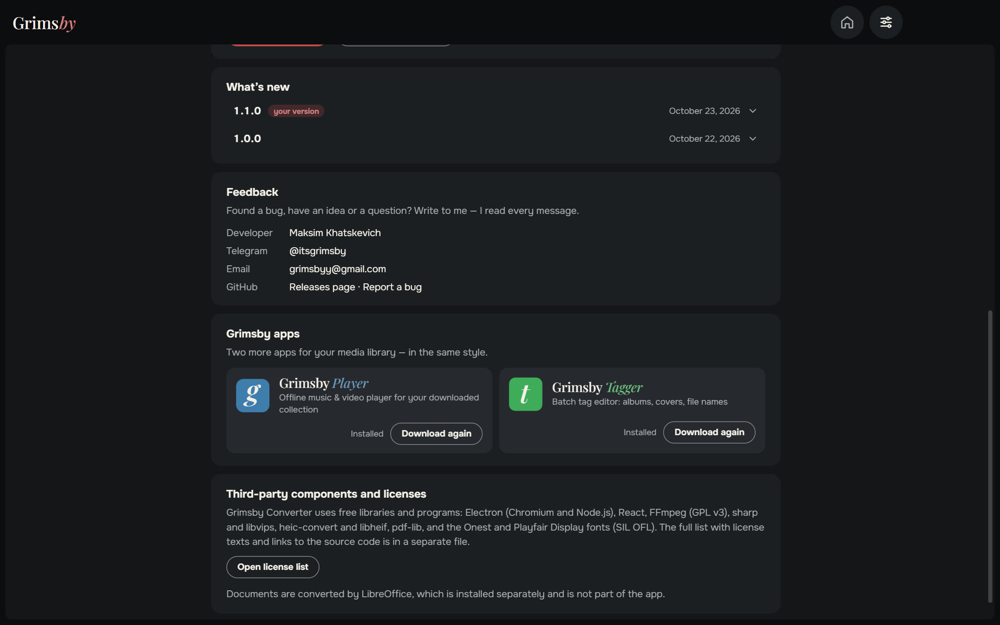
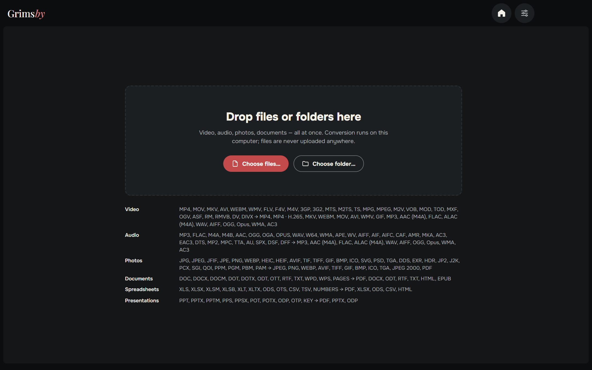

  <b>English</b> ·
  <a href="README.ru.md">Русский</a> ·
  <a href="README.es.md">Español</a> ·
  <a href="README.pt.md">Português</a> ·
  <a href="README.de.md">Deutsch</a> ·
  <a href="README.fr.md">Français</a> ·
  <a href="README.zh.md">中文</a> ·
  <a href="README.ja.md">日本語</a> ·
  <a href="README.ko.md">한국어</a>

  

  <b>Convert video, audio, photos and documents — all at once, right on your PC.</b> 
  Nothing is uploaded anywhere: no waiting in an online queue, no file size limits, no watermarks.

  
  
  
  
  

  <a href="https://github.com/maksimkhatskevich/grimsby-converter/releases/latest"><b>⬇ Download for Windows</b></a>
  &nbsp;·&nbsp;
  <a href="#features">Features</a>
  &nbsp;·&nbsp;
  <a href="#formats">Formats</a>
  &nbsp;·&nbsp;
  <a href="#feedback">Feedback</a>

---

## Why Grimsby Converter

Need a FLAC album as MP3 for your phone, a MOV from an iPhone as MP4, HEIC photos as JPG and a DOCX as PDF? Usually that means four different websites, uploading private files to someone else's server and waiting in line.

**Grimsby Converter does it in one window.** Drop in files and folders in any mix — they are sorted into groups, and each group gets its own format and quality. One button, and everything is converted on your computer.

| | Online converters | **Grimsby Converter** |
|---|:---:|:---:|
| Files stay on your computer | ✕ | **✓** |
| No size limits, no waiting in a queue | ✕ | **✓** |
| Video, audio, photos and documents in one place | rarely | **✓** |
| Whole folders at once | ✕ | **✓** |
| Works without internet | ✕ | **✓** |
| No ads, no watermarks, no sign-up | rarely | **✓** |

---

## Features

### 📥 Drop everything at once

Drag files or whole folders into the window — video, music, photos and documents mixed together. Grimsby sorts them into groups by type and shows how many files are in each.

### 🎚 Each group gets its own settings

Pick the target format and quality per group: say, video to MP4, music to MP3 320 kbps, photos to WEBP.

- **Video — "Fast" mode:** if the codec fits the new container, the video is simply repackaged (MOV → MP4 in seconds, with zero quality loss). If not — or if the format is one many players can't open — it's re-encoded. **MP4 · H.265** makes the file about half the size.
- **Audio:** from MP3 and FLAC to DSD, DTS and M4B audiobooks; save to ALAC, AIFF, WMA and more. Tags carry over to the new files.
- **Photos:** HEIC from iPhone, Photoshop PSD, EXR, HDR, AVIF, SVG — everything opens and saves in the usual formats, even to PDF.
- **Documents, spreadsheets, presentations** → PDF, DOCX, XLSX, EPUB and more; Pages, Numbers and Keynote files open too.

### ⚡ Fast and safe

- Several files are converted at the same time — as many as your processor can handle.
- **Originals are never touched.** The new file is written next to the original (or to a folder you choose) and appears only once it's fully ready.
- For every finished file you see how much space it saved, and a "Show" button opens it in Explorer.
- Everything needed for video, audio and photos is already inside — nothing else to install.

### ⚙️ Settings on one page

Language, documents, updates (notify only, automatically or don't check), what's new and feedback — all on a single page. The window remembers its size and position.

🌍 **9 languages:** English, Russian, Spanish, Portuguese, German, French, Chinese, Japanese and Korean — switch in Settings, it changes right away.

### 🧩 Grimsby apps inside

Grimsby Player and Grimsby Tagger with descriptions and screenshots — download and install them right from the app.

---

## Formats

| Group | Opens | Saves to |
|---|---|---|
| 🎬 Video | MP4, MOV, MKV, AVI, WEBM, WMV, FLV, F4V, M4V, 3GP, 3G2, MTS, M2TS, TS, MPG, MPEG, M2V, VOB, MOD, TOD, MXF, OGV, ASF, RM, RMVB, DV, DIVX | MP4, MP4 · H.265, MKV, WEBM, MOV, AVI, WMV, GIF; sound only → MP3, AAC (M4A), FLAC, ALAC (M4A), WAV, AIFF, OGG, Opus, WMA, AC3 |
| 🎵 Audio | MP3, FLAC, M4A, M4B, AAC, OGG, OGA, OPUS, WAV, W64, WMA, APE, WV, AIFF, AIF, AIFC, CAF, AMR, MKA, AC3, EAC3, DTS, MP2, MPC, TTA, AU, SPX, DSF, DFF | MP3, AAC (M4A), FLAC, ALAC (M4A), WAV, AIFF, OGG, Opus, WMA, AC3 |
| 🖼 Photos | JPG, JPEG, JFIF, PNG, WEBP, HEIC, HEIF, AVIF, TIF, TIFF, GIF, BMP, ICO, SVG, PSD, TGA, DDS, EXR, HDR, JP2, J2K, PCX, SGI, QOI, PPM, PGM, PBM, PAM | JPEG, PNG, WEBP, AVIF, TIFF, GIF, BMP, ICO, TGA, JPEG 2000, PDF |
| 📄 Documents | DOC, DOCX, DOCM, DOT, DOTX, ODT, OTT, RTF, TXT, WPD, WPS, PAGES | PDF, DOCX, ODT, RTF, TXT, HTML, EPUB |
| 📊 Spreadsheets | XLS, XLSX, XLSM, XLSB, XLT, XLTX, ODS, OTS, CSV, TSV, NUMBERS | PDF, XLSX, ODS, CSV, HTML |
| 📽 Presentations | PPT, PPTX, PPTM, PPS, PPSX, POT, POTX, ODP, OTP, KEY | PDF, PPTX, ODP |

> Documents, spreadsheets and presentations are converted with the free **LibreOffice** suite. If it isn't installed, Grimsby will offer to download it. Video, audio and photos work right away.

---

## Download and install

1. Open the **[latest release](https://github.com/maksimkhatskevich/grimsby-converter/releases/latest)** page and download the installer `.exe`.
2. Run it. Windows may show a blue "Windows protected your PC" window — that's a normal warning for apps without a paid code-signing certificate. Click **More info → Run anyway**.
   The installer has been checked on VirusTotal: [0 of 67 antivirus engines flag it](https://www.virustotal.com/gui/file/caeade773641b7b2a15fcc427afa02305a45262004d60aade01427700477fd3b) (version 1.1.0).
3. Drop your files into the window. That's it.

**Requirements:** Windows 10 or 11 (64-bit).

---

## Privacy

Grimsby Converter works **entirely on your computer**. Files are never uploaded anywhere. No accounts, no ads, no analytics.

---

## Grimsby apps

<table>
  <tr>
    <td align="center" width="33%"><a href="https://github.com/maksimkhatskevich/grimsby-releases"> <b>Grimsby Player</b></a> Offline music & video player for your downloaded collection</td>
    <td align="center" width="33%"> <b>Grimsby Converter</b> </td>
    <td align="center" width="33%"><a href="https://github.com/maksimkhatskevich/grimsby-tagger"> <b>Grimsby Tagger</b></a> Batch tag editor: albums, covers, file names</td>
  </tr>
</table>

---

## Feedback

Found a bug, have an idea or just want to say thanks? Get in touch:

- ✉️ email: **[grimsbyy@gmail.com](mailto:grimsbyy@gmail.com)**
- 🐞 bugs and ideas: [Issues](https://github.com/maksimkhatskevich/grimsby-converter/issues)
- 📣 Telegram: [@itsgrimsby](https://t.me/itsgrimsby) (in Russian)

---

## Licenses

Grimsby Converter uses open-source components, including Electron, React, FFmpeg (GPL v3) and libvips. The full list with license texts is in the app: Settings → Open license list.

© 2026 Grimsby

