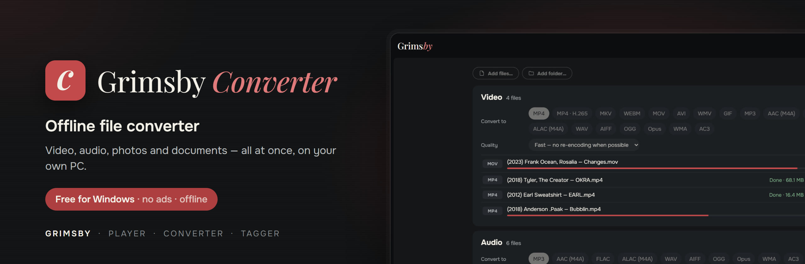
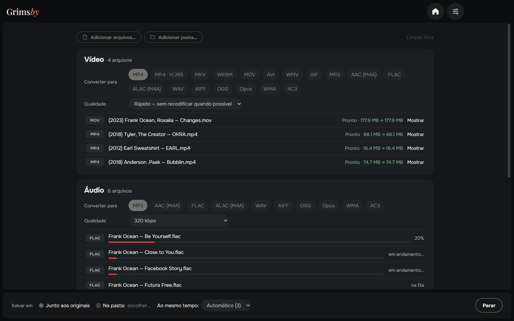
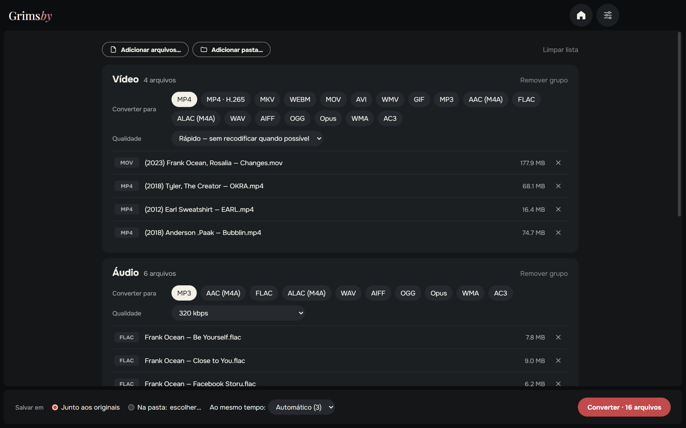
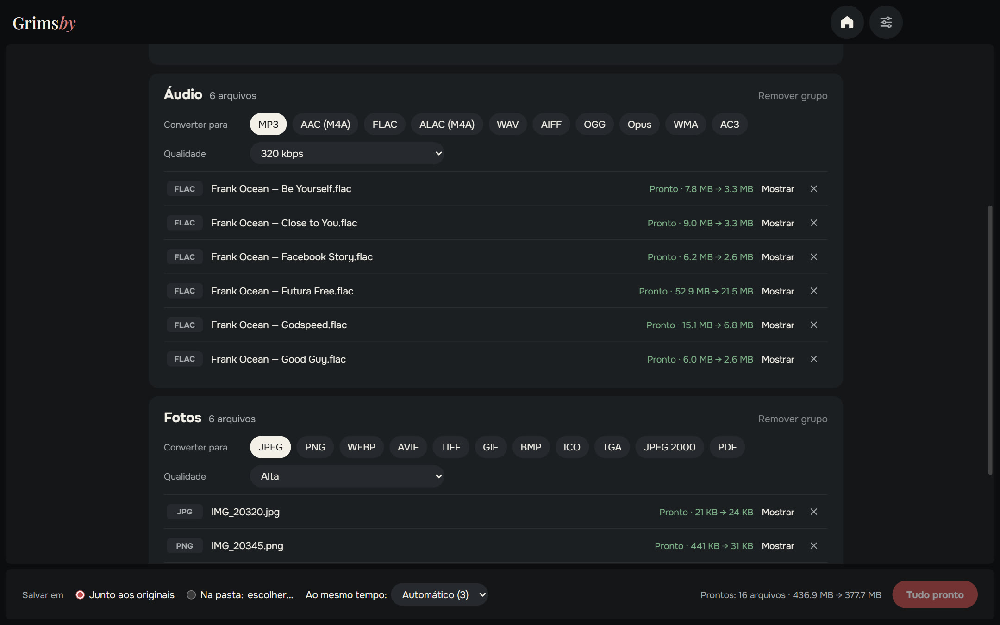
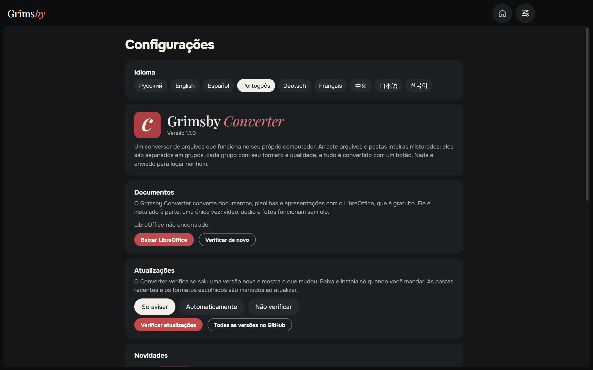
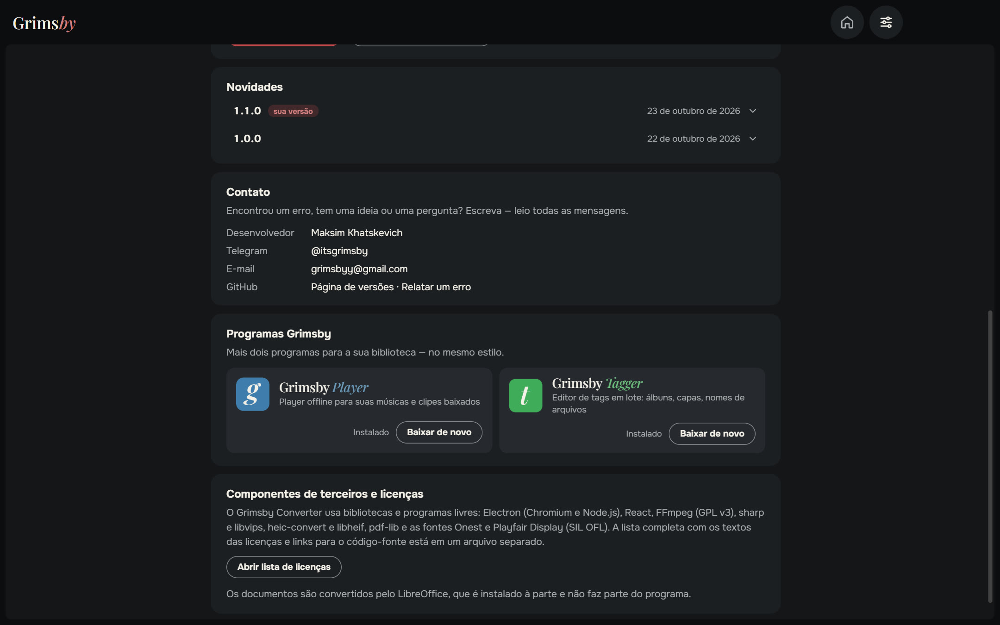
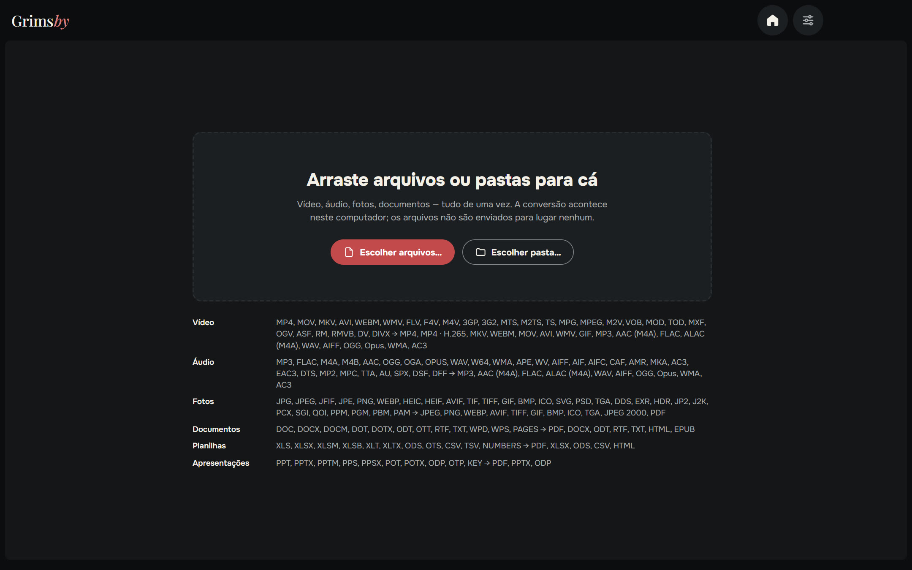

  <a href="README.md">English</a> ·
  <a href="README.ru.md">Русский</a> ·
  <a href="README.es.md">Español</a> ·
  <b>Português</b> ·
  <a href="README.de.md">Deutsch</a> ·
  <a href="README.fr.md">Français</a> ·
  <a href="README.zh.md">中文</a> ·
  <a href="README.ja.md">日本語</a> ·
  <a href="README.ko.md">한국어</a>

  

  <b>Converta vídeo, áudio, fotos e documentos — tudo de uma vez, no seu próprio computador.</b> 
  Nada é enviado para lugar nenhum: sem filas em sites, sem limite de tamanho, sem marca-d’água.

  
  
  
  
  

  <a href="https://github.com/maksimkhatskevich/grimsby-converter/releases/latest"><b>⬇ Baixar para Windows</b></a>
  &nbsp;·&nbsp;
  <a href="#recursos">Recursos</a>
  &nbsp;·&nbsp;
  <a href="#formatos">Formatos</a>
  &nbsp;·&nbsp;
  <a href="#contato">Contato</a>

---

## Por que o Grimsby Converter

Precisa de um álbum FLAC em MP3 para o celular, um MOV do iPhone em MP4, fotos HEIC em JPG e um DOCX em PDF? Normalmente são quatro sites diferentes, enviar arquivos pessoais para o servidor de outra pessoa e esperar na fila.

**O Grimsby Converter faz isso em uma só janela.** Arraste arquivos e pastas misturados — eles são separados em grupos, cada um com seu formato e qualidade. Um botão, e tudo é convertido no seu computador.

| | Conversores online | **Grimsby Converter** |
|---|:---:|:---:|
| Os arquivos ficam no seu computador | ✕ | **✓** |
| Sem limite de tamanho e sem filas | ✕ | **✓** |
| Vídeo, áudio, fotos e documentos em um só lugar | às vezes | **✓** |
| Pastas inteiras de uma vez | ✕ | **✓** |
| Funciona sem internet | ✕ | **✓** |
| Sem anúncios, marca-d’água ou cadastro | às vezes | **✓** |

---

## Recursos

### 📥 Tudo de uma vez

Arraste para a janela arquivos ou pastas inteiras — vídeo, música, fotos e documentos misturados. O Grimsby separa tudo em grupos por tipo e mostra quantos arquivos há em cada um.

### 🎚 Cada grupo com suas configurações

Escolha o formato e a qualidade por grupo: por exemplo, vídeo para MP4, música para MP3 320 kbps, fotos para WEBP.

- **Vídeo — modo «Rápido»:** se o codec cabe no novo contêiner, o vídeo é só reempacotado (MOV → MP4 em segundos, sem perda de qualidade). Se não — ou se muitos players não abrem o formato — ele é recodificado. **MP4 · H.265** deixa o arquivo com cerca de metade do tamanho.
- **Áudio:** de MP3 e FLAC a DSD, DTS e audiolivros M4B; salva também em ALAC, AIFF, WMA e outros. As tags vão para os novos arquivos.
- **Fotos:** HEIC do iPhone, PSD do Photoshop, EXR, HDR, AVIF, SVG — tudo abre e é salvo nos formatos de sempre, até em PDF.
- **Documentos, planilhas, apresentações** → PDF, DOCX, XLSX, EPUB e outros; arquivos do Pages, Numbers e Keynote também abrem.

### ⚡ Rápido e seguro

- Vários arquivos ao mesmo tempo — quantos o processador aguentar.
- **Os originais ficam intactos.** O novo arquivo é gravado ao lado do original (ou na pasta escolhida) e só aparece quando está totalmente pronto.
- Em cada arquivo pronto você vê quanto espaço economizou, e o botão «Mostrar» abre o arquivo no Explorador.
- Tudo o que é preciso para vídeo, áudio e fotos já vem dentro — nada mais para instalar.

### ⚙️ Configurações em uma página

Idioma, documentos, atualizações (só avisar, automaticamente ou não verificar), novidades e contato — tudo em uma página. A janela lembra o tamanho e a posição.

🌍 **9 idiomas:** inglês, russo, espanhol, português, alemão, francês, chinês, japonês e coreano — troque nas Configurações, muda na hora.

### 🧩 Os apps Grimsby por dentro

Grimsby Player e Grimsby Tagger com descrição e capturas de tela — baixe e instale direto do app.

---

## Formatos

| Grupo | Abre | Salva em |
|---|---|---|
| 🎬 Vídeo | MP4, MOV, MKV, AVI, WEBM, WMV, FLV, F4V, M4V, 3GP, 3G2, MTS, M2TS, TS, MPG, MPEG, M2V, VOB, MOD, TOD, MXF, OGV, ASF, RM, RMVB, DV, DIVX | MP4, MP4 · H.265, MKV, WEBM, MOV, AVI, WMV, GIF; só o som → MP3, AAC (M4A), FLAC, ALAC (M4A), WAV, AIFF, OGG, Opus, WMA, AC3 |
| 🎵 Áudio | MP3, FLAC, M4A, M4B, AAC, OGG, OGA, OPUS, WAV, W64, WMA, APE, WV, AIFF, AIF, AIFC, CAF, AMR, MKA, AC3, EAC3, DTS, MP2, MPC, TTA, AU, SPX, DSF, DFF | MP3, AAC (M4A), FLAC, ALAC (M4A), WAV, AIFF, OGG, Opus, WMA, AC3 |
| 🖼 Fotos | JPG, JPEG, JFIF, PNG, WEBP, HEIC, HEIF, AVIF, TIF, TIFF, GIF, BMP, ICO, SVG, PSD, TGA, DDS, EXR, HDR, JP2, J2K, PCX, SGI, QOI, PPM, PGM, PBM, PAM | JPEG, PNG, WEBP, AVIF, TIFF, GIF, BMP, ICO, TGA, JPEG 2000, PDF |
| 📄 Documentos | DOC, DOCX, DOCM, DOT, DOTX, ODT, OTT, RTF, TXT, WPD, WPS, PAGES | PDF, DOCX, ODT, RTF, TXT, HTML, EPUB |
| 📊 Planilhas | XLS, XLSX, XLSM, XLSB, XLT, XLTX, ODS, OTS, CSV, TSV, NUMBERS | PDF, XLSX, ODS, CSV, HTML |
| 📽 Apresentações | PPT, PPTX, PPTM, PPS, PPSX, POT, POTX, ODP, OTP, KEY | PDF, PPTX, ODP |

> Documentos, planilhas e apresentações são convertidos com o pacote gratuito **LibreOffice**. Se ele não estiver instalado, o Grimsby oferece o download. Vídeo, áudio e fotos funcionam na hora.

---

## Baixar e instalar

1. Abra a página da **[versão mais recente](https://github.com/maksimkhatskevich/grimsby-converter/releases/latest)** e baixe o instalador `.exe`.
2. Execute-o. O Windows pode mostrar uma janela azul «O Windows protegeu o computador» — é um aviso normal para programas sem certificado de assinatura pago. Clique em **Mais informações → Executar assim mesmo**.
   O instalador foi verificado no VirusTotal: [nenhum dos 67 antivírus encontrou nada](https://www.virustotal.com/gui/file/caeade773641b7b2a15fcc427afa02305a45262004d60aade01427700477fd3b) (versão 1.1.0).
3. Arraste os arquivos para a janela. Pronto.

**Requisitos:** Windows 10 ou 11 (64 bits).

---

## Privacidade

O Grimsby Converter funciona **inteiramente no seu computador**. Os arquivos não são enviados para lugar nenhum. Sem contas, sem anúncios, sem análises.

---

## Os apps Grimsby

<table>
  <tr>
    <td align="center" width="33%"><a href="https://github.com/maksimkhatskevich/grimsby-releases/blob/main/README.pt.md"> <b>Grimsby Player</b></a> Player offline para suas músicas e clipes baixados</td>
    <td align="center" width="33%"> <b>Grimsby Converter</b> </td>
    <td align="center" width="33%"><a href="https://github.com/maksimkhatskevich/grimsby-tagger/blob/main/README.pt.md"> <b>Grimsby Tagger</b></a> Editor de tags em lote: álbuns, capas, nomes de arquivos</td>
  </tr>
</table>

---

## Contato

Encontrou um erro, tem uma ideia ou só quer agradecer? Escreva:

- ✉️ e-mail: **[grimsbyy@gmail.com](mailto:grimsbyy@gmail.com)**
- 🐞 erros e ideias: [Issues](https://github.com/maksimkhatskevich/grimsby-converter/issues)
- 📣 Telegram: [@itsgrimsby](https://t.me/itsgrimsby) (em russo)

---

## Licenças

O Grimsby Converter usa componentes de código aberto, incluindo Electron, React, FFmpeg (GPL v3) e libvips. A lista completa com os textos das licenças está no app: Configurações → Abrir a lista de licenças.

© 2026 Grimsby

