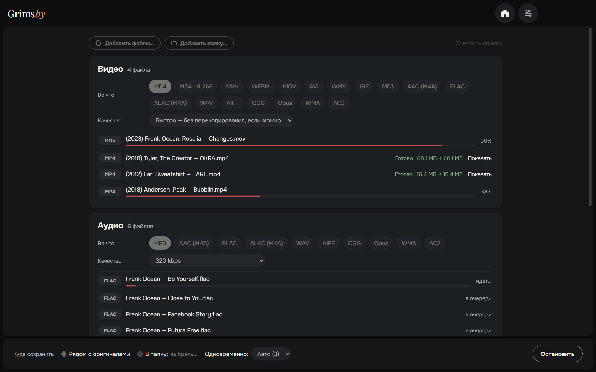
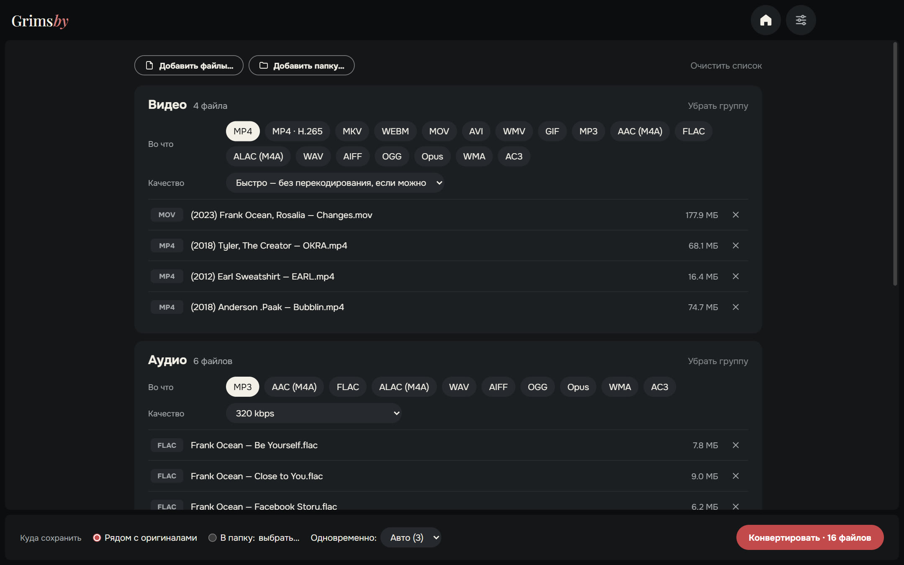
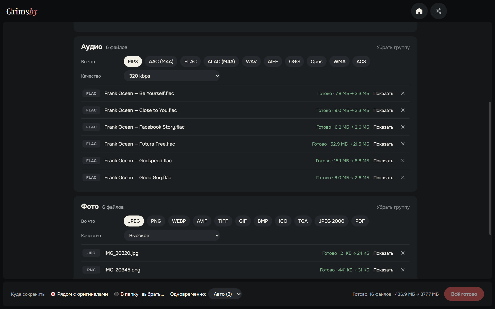
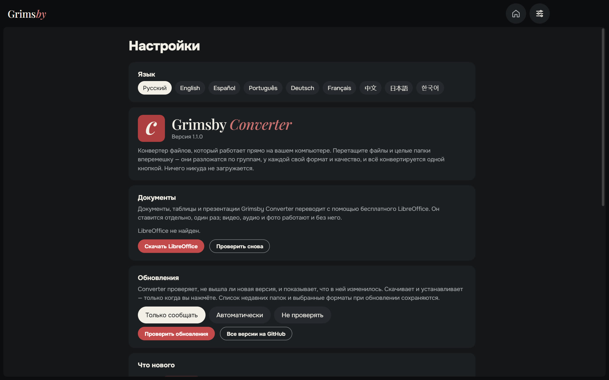
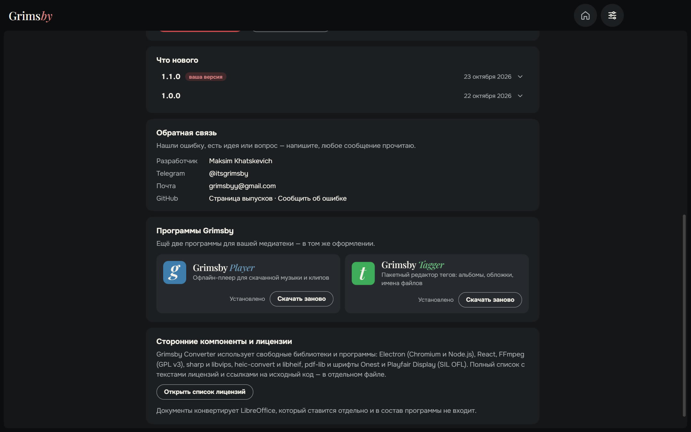
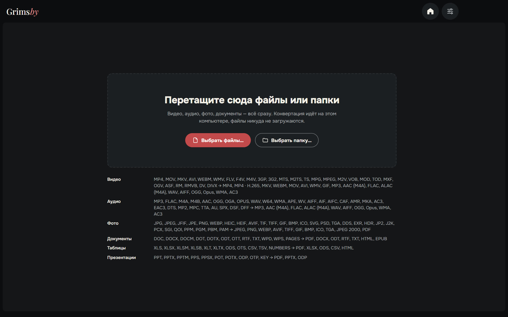

  <a href="README.md">English</a> ·
  <b>Русский</b> ·
  <a href="README.es.md">Español</a> ·
  <a href="README.pt.md">Português</a> ·
  <a href="README.de.md">Deutsch</a> ·
  <a href="README.fr.md">Français</a> ·
  <a href="README.zh.md">中文</a> ·
  <a href="README.ja.md">日本語</a> ·
  <a href="README.ko.md">한국어</a>

  

  <b>Конвертируйте видео, аудио, фото и документы — всё сразу и прямо на своём компьютере.</b> 
  Файлы никуда не загружаются: ни очередей на сайтах, ни ограничений по размеру, ни водяных знаков.

  
  
  
  
  

  <a href="https://github.com/maksimkhatskevich/grimsby-converter/releases/latest"><b>⬇ Скачать для Windows</b></a>
  &nbsp;·&nbsp;
  <a href="#возможности">Возможности</a>
  &nbsp;·&nbsp;
  <a href="#форматы">Форматы</a>
  &nbsp;·&nbsp;
  <a href="#обратная-связь">Обратная связь</a>

---

## Зачем Grimsby Converter

Нужно перегнать альбом во FLAC в MP3 для телефона, видео MOV с айфона в MP4, фото HEIC в JPG, а DOCX — в PDF? Обычно это четыре разных сайта, загрузка личных файлов на чужой сервер и ожидание в очереди.

**Grimsby Converter делает это в одном окне.** Перетащите файлы и папки вперемешку — они разложатся по группам, у каждой группы свой формат и качество. Одна кнопка, и всё конвертируется на вашем компьютере.

| | Онлайн-конвертеры | **Grimsby Converter** |
|---|:---:|:---:|
| Файлы остаются на вашем компьютере | ✕ | **✓** |
| Нет ограничений по размеру и очередей | ✕ | **✓** |
| Видео, аудио, фото и документы в одном месте | редко | **✓** |
| Целые папки за раз | ✕ | **✓** |
| Работает без интернета | ✕ | **✓** |
| Без рекламы, водяных знаков и регистрации | редко | **✓** |

---

## Возможности

### 📥 Всё одним движением

Перетащите в окно файлы или целые папки — видео, музыку, фото и документы вперемешку. Grimsby разложит их по группам и покажет, сколько файлов в каждой.

### 🎚 У каждой группы свои настройки

Формат и качество выбираются для группы целиком: например, видео — в MP4, музыка — в MP3 320 кбит/с, фото — в WEBP.

- **Видео — режим «Быстро»:** если кодек подходит новому контейнеру, видео просто переупаковывается (MOV → MP4 за секунды, без потери качества). Если нет — или формат многие плееры не откроют, — перекодируется. **MP4 · H.265** — файл примерно вдвое меньше.
- **Аудио:** от MP3 и FLAC до DSD, DTS и аудиокниг M4B; сохраняет и в ALAC, AIFF, WMA. Теги переносятся в новые файлы.
- **Фото:** HEIC с айфона, PSD из Photoshop, EXR, HDR, AVIF, SVG — всё открывается и сохраняется в привычные форматы, даже в PDF.
- **Документы, таблицы, презентации** → PDF, DOCX, XLSX, EPUB и другие; открываются и файлы Pages, Numbers и Keynote.

### ⚡ Быстро и безопасно

- Несколько файлов конвертируются одновременно — столько, сколько потянет процессор.
- **Оригиналы не трогаются.** Новый файл пишется рядом с исходным (или в выбранную папку) и появляется, только когда полностью готов.
- У каждого готового файла видно, сколько места он сэкономил, а кнопка «Показать» открывает его в Проводнике.
- Всё нужное для видео, аудио и фото уже внутри — ничего не нужно ставить отдельно.

### ⚙️ Настройки на одной странице

Язык, документы, обновления (только сообщать, автоматически или не проверять), «Что нового» и обратная связь — всё на одной странице. Окно запоминает размер и положение.

🌍 **9 языков:** русский, английский, испанский, португальский, немецкий, французский, китайский, японский и корейский — переключаются в настройках сразу.

### 🧩 Программы Grimsby внутри

Grimsby Player и Grimsby Tagger с описанием и скриншотами — скачать и установить можно прямо из программы.

---

## Форматы

| Группа | Открывает | Сохраняет в |
|---|---|---|
| 🎬 Видео | MP4, MOV, MKV, AVI, WEBM, WMV, FLV, F4V, M4V, 3GP, 3G2, MTS, M2TS, TS, MPG, MPEG, M2V, VOB, MOD, TOD, MXF, OGV, ASF, RM, RMVB, DV, DIVX | MP4, MP4 · H.265, MKV, WEBM, MOV, AVI, WMV, GIF; только звук → MP3, AAC (M4A), FLAC, ALAC (M4A), WAV, AIFF, OGG, Opus, WMA, AC3 |
| 🎵 Аудио | MP3, FLAC, M4A, M4B, AAC, OGG, OGA, OPUS, WAV, W64, WMA, APE, WV, AIFF, AIF, AIFC, CAF, AMR, MKA, AC3, EAC3, DTS, MP2, MPC, TTA, AU, SPX, DSF, DFF | MP3, AAC (M4A), FLAC, ALAC (M4A), WAV, AIFF, OGG, Opus, WMA, AC3 |
| 🖼 Фото | JPG, JPEG, JFIF, PNG, WEBP, HEIC, HEIF, AVIF, TIF, TIFF, GIF, BMP, ICO, SVG, PSD, TGA, DDS, EXR, HDR, JP2, J2K, PCX, SGI, QOI, PPM, PGM, PBM, PAM | JPEG, PNG, WEBP, AVIF, TIFF, GIF, BMP, ICO, TGA, JPEG 2000, PDF |
| 📄 Документы | DOC, DOCX, DOCM, DOT, DOTX, ODT, OTT, RTF, TXT, WPD, WPS, PAGES | PDF, DOCX, ODT, RTF, TXT, HTML, EPUB |
| 📊 Таблицы | XLS, XLSX, XLSM, XLSB, XLT, XLTX, ODS, OTS, CSV, TSV, NUMBERS | PDF, XLSX, ODS, CSV, HTML |
| 📽 Презентации | PPT, PPTX, PPTM, PPS, PPSX, POT, POTX, ODP, OTP, KEY | PDF, PPTX, ODP |

> Документы, таблицы и презентации конвертируются бесплатным пакетом **LibreOffice**. Если его нет, Grimsby предложит скачать. Видео, аудио и фото работают сразу.

---

## Скачать и установить

1. Откройте страницу **[последней версии](https://github.com/maksimkhatskevich/grimsby-converter/releases/latest)** и скачайте установщик `.exe`.
2. Запустите его. Windows может показать синее окно «Система Windows защитила ваш компьютер» — это обычное предупреждение для программ без платного сертификата подписи. Нажмите **Подробнее → Выполнить в любом случае**.
   Установщик проверен на VirusTotal: [ни один из 67 антивирусов ничего не нашёл](https://www.virustotal.com/gui/file/caeade773641b7b2a15fcc427afa02305a45262004d60aade01427700477fd3b) (версия 1.1.0).
3. Перетащите файлы в окно. Готово.

**Требования:** Windows 10 или 11 (64 бит).

---

## Приватность

Grimsby Converter работает **полностью на вашем компьютере**. Файлы никуда не загружаются. Без аккаунтов, рекламы и аналитики.

---

## Программы Grimsby

<table>
  <tr>
    <td align="center" width="33%"><a href="https://github.com/maksimkhatskevich/grimsby-releases/blob/main/README.ru.md"> <b>Grimsby Player</b></a> Офлайн-плеер для скачанной музыки и клипов</td>
    <td align="center" width="33%"> <b>Grimsby Converter</b> </td>
    <td align="center" width="33%"><a href="https://github.com/maksimkhatskevich/grimsby-tagger/blob/main/README.ru.md"> <b>Grimsby Tagger</b></a> Пакетный редактор тегов: альбомы, обложки, имена файлов</td>
  </tr>
</table>

---

## Обратная связь

Нашли ошибку, есть идея или просто хотите сказать спасибо? Пишите:

- ✉️ почта: **[grimsbyy@gmail.com](mailto:grimsbyy@gmail.com)**
- 🐞 ошибки и идеи: [Issues](https://github.com/maksimkhatskevich/grimsby-converter/issues)
- 📣 Telegram: [@itsgrimsby](https://t.me/itsgrimsby)

---

## Лицензии

Grimsby Converter использует компоненты с открытым кодом, в том числе Electron, React, FFmpeg (GPL v3) и libvips. Полный список с текстами лицензий — в программе: Настройки → Открыть список лицензий.

© 2026 Grimsby

