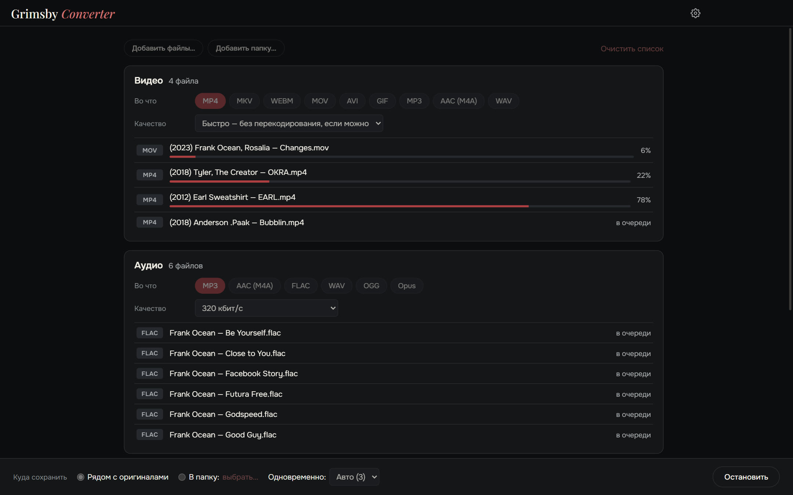
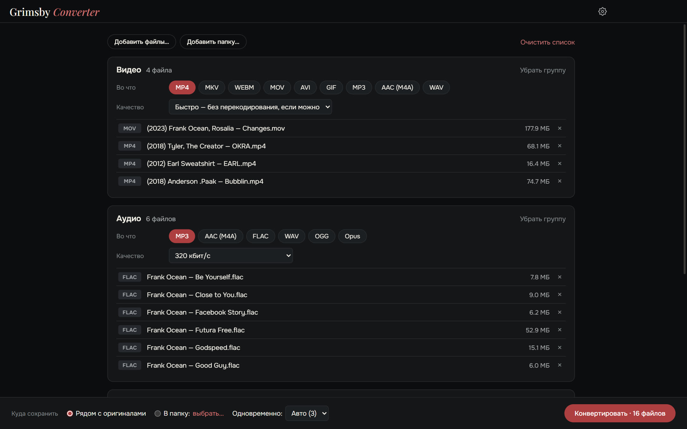
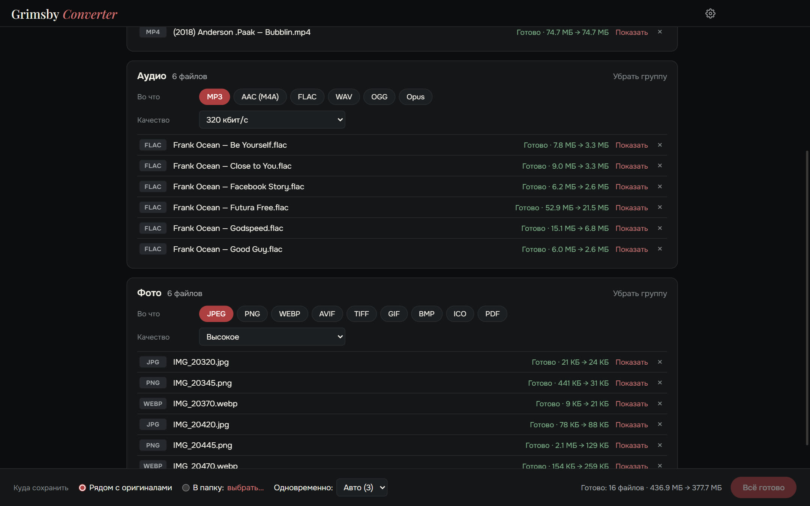

  <a href="README.md">English</a> ·
  <b>Русский</b>

  

  <b>Конвертируйте видео, аудио, фото и документы — всё сразу и прямо на своём компьютере.</b> 
  Файлы никуда не загружаются: ни очередей на сайтах, ни ограничений по размеру, ни водяных знаков.

  
  
  
  
  

  <a href="https://github.com/maksimkhatskevich/grimsby-converter/releases/latest"><b>⬇ Скачать для Windows</b></a>
  &nbsp;·&nbsp;
  <a href="#возможности">Возможности</a>
  &nbsp;·&nbsp;
  <a href="#форматы">Форматы</a>
  &nbsp;·&nbsp;
  <a href="#обратная-связь">Обратная связь</a>

---

## Зачем Grimsby Converter

Нужно перегнать альбом во FLAC в MP3 для телефона, видео MOV с айфона в MP4, фото HEIC в JPG, а DOCX — в PDF?
Обычно это четыре разных сайта, загрузка личных файлов на чужой сервер и ожидание в очереди.

**Grimsby Converter делает это в одном окне.** Перетащите файлы и папки вперемешку — они разложатся по группам,
у каждой группы свой формат и качество. Одна кнопка, и всё конвертируется на вашем компьютере.

| | Онлайн-конвертеры | **Grimsby Converter** |
|---|:---:|:---:|
| Файлы остаются на вашем компьютере | ✕ | **✓** |
| Нет ограничений по размеру и очередей | ✕ | **✓** |
| Видео, аудио, фото и документы в одном месте | редко | **✓** |
| Целые папки за раз | ✕ | **✓** |
| Работает без интернета | ✕ | **✓** |
| Без рекламы, водяных знаков и регистрации | редко | **✓** |

---

## Возможности

### 📥 Всё одним движением

Перетащите в окно файлы или целые папки — видео, музыку, фото и документы вперемешку.
Grimsby разложит их по группам и покажет, сколько файлов в каждой.

### 🎚 У каждой группы свои настройки

Формат и качество выбираются для группы целиком: например, видео — в MP4, музыка — в MP3 320 кбит/с, фото — в WEBP.

- **Видео — режим «Быстро»:** если кодек подходит новому контейнеру, видео просто переупаковывается
  (MOV → MP4 за секунды, без потери качества). Если нет — перекодируется в H.264/AAC.
- **Аудио:** теги (исполнитель, альбом, название, год) переносятся в новые файлы.
- **Фото:** HEIC с айфона, AVIF, WEBP, SVG — всё открывается и сохраняется в привычные форматы, даже в PDF.
- **Документы, таблицы, презентации** → PDF, DOCX, XLSX и другие.

### ⚡ Быстро и безопасно

- Несколько файлов конвертируются одновременно — столько, сколько потянет процессор.
- **Оригиналы не трогаются.** Новый файл пишется рядом с исходным (или в выбранную папку)
  и появляется, только когда полностью готов: недописанных файлов не бывает.
- У каждого готового файла видно, сколько места он сэкономил, а кнопка «Показать» открывает его в Проводнике.

---

## Форматы

| Группа | Открывает | Сохраняет в |
|---|---|---|
| 🎬 Видео | MP4, MOV, MKV, AVI, WEBM, WMV, FLV, M4V, 3GP, MTS, M2TS, TS, MPG, VOB | MP4, MKV, WEBM, MOV, AVI, GIF; только звук → MP3, AAC, WAV |
| 🎵 Аудио | MP3, FLAC, M4A, AAC, OGG, OPUS, WAV, WMA, APE, WV, AIFF, AMR, MKA | MP3, AAC, FLAC, WAV, OGG, Opus |
| 🖼 Фото | JPG, PNG, WEBP, HEIC/HEIF, AVIF, TIFF, GIF, BMP, ICO, SVG | JPEG, PNG, WEBP, AVIF, TIFF, GIF, BMP, ICO, PDF |
| 📄 Документы | DOC, DOCX, ODT, RTF, TXT | PDF, DOCX, ODT, RTF, TXT, HTML |
| 📊 Таблицы | XLS, XLSX, ODS, CSV | PDF, XLSX, ODS, CSV |
| 📽 Презентации | PPT, PPTX, ODP | PDF, PPTX, ODP |

> Документы, таблицы и презентации конвертируются бесплатным пакетом **LibreOffice**.
> Если его нет, Grimsby предложит скачать. Видео, аудио и фото работают сразу.

---

## Скачать и установить

1. Откройте страницу **[последней версии](https://github.com/maksimkhatskevich/grimsby-converter/releases/latest)** и скачайте установщик `.exe`.
2. Запустите его. Windows может показать синее окно «Система Windows защитила ваш компьютер» — это обычное
   предупреждение для программ без платного сертификата подписи. Нажмите **Подробнее → Выполнить в любом случае**.
   Установщик проверен на VirusTotal: [ни один из 66 антивирусов ничего не нашёл](https://www.virustotal.com/gui/file/cedcbb0af1dcbae43e6d6f878c1dcf82fe14c66bdd7b8cebf78af7fe7eeea2ec) (версия 1.0.0).
3. Перетащите файлы в окно. Готово.

**Требования:** Windows 10 или 11 (64 бит).

---

## Приватность

Grimsby Converter работает **полностью на вашем компьютере**. Файлы никуда не загружаются. Без аккаунтов, рекламы и аналитики.

---

## Программы Grimsby

<table>
  <tr>
    <td align="center" width="33%"><a href="https://github.com/maksimkhatskevich/grimsby-releases/blob/main/README.ru.md"> <b>Grimsby Player</b></a> Офлайн-плеер для скачанной музыки и клипов</td>
    <td align="center" width="33%"> <b>Grimsby Converter</b> </td>
    <td align="center" width="33%"><a href="https://github.com/maksimkhatskevich/grimsby-tagger/blob/main/README.ru.md"> <b>Grimsby Tagger</b></a> Пакетный редактор тегов: альбомы, обложки, имена файлов</td>
  </tr>
</table>

---

## Обратная связь

Нашли ошибку, есть идея или просто хотите сказать спасибо? Пишите:

- ✉️ почта: **[grimsbyy@gmail.com](mailto:grimsbyy@gmail.com)**
- 🐞 ошибки и идеи: [Issues](https://github.com/maksimkhatskevich/grimsby-converter/issues)
- 📣 Telegram: [@itsgrimsby](https://t.me/itsgrimsby)

---

## Лицензии

Grimsby Converter использует компоненты с открытым кодом, в том числе Electron, React, FFmpeg (GPL v3) и libvips.
Полный список с текстами лицензий — в программе: Настройки → Лицензии компонентов.

© 2026 Grimsby

