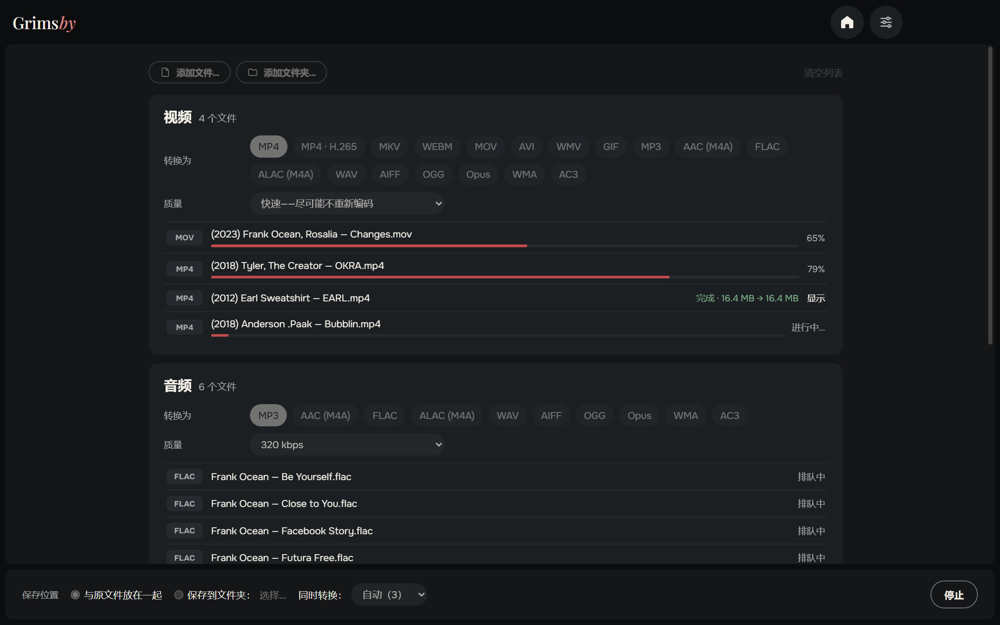
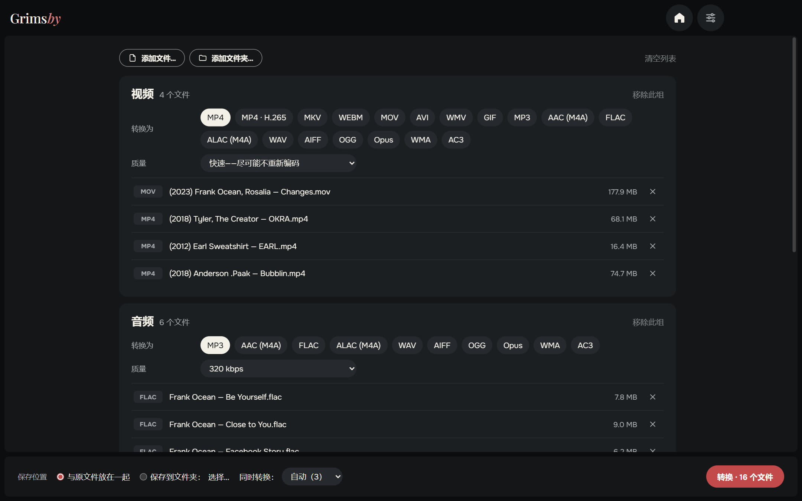
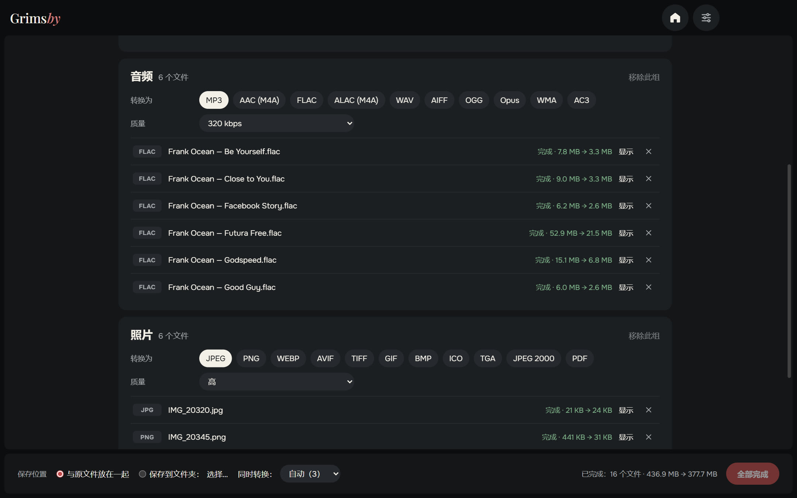
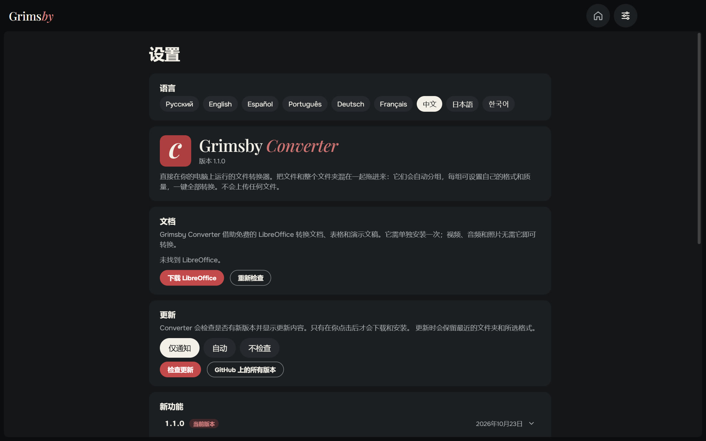
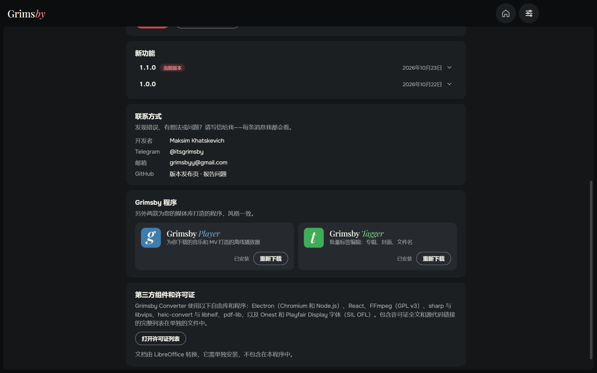
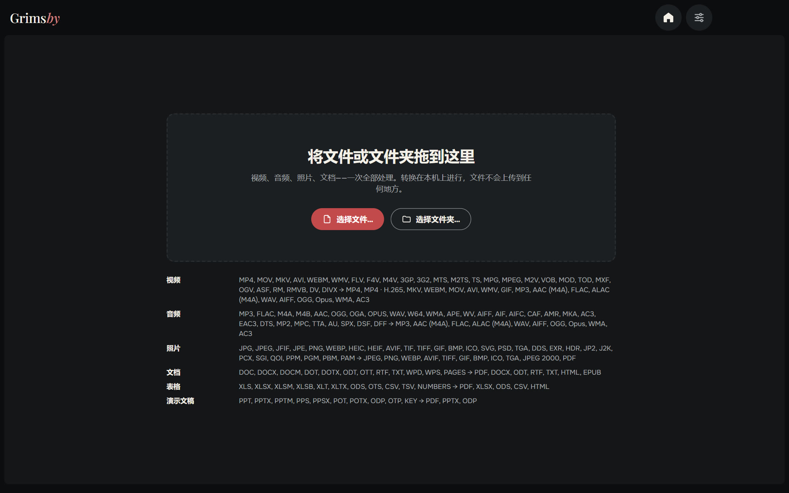

  <a href="README.md">English</a> ·
  <a href="README.ru.md">Русский</a> ·
  <a href="README.es.md">Español</a> ·
  <a href="README.pt.md">Português</a> ·
  <a href="README.de.md">Deutsch</a> ·
  <a href="README.fr.md">Français</a> ·
  <b>中文</b> ·
  <a href="README.ja.md">日本語</a> ·
  <a href="README.ko.md">한국어</a>

  

  <b>视频、音频、照片和文档，一次全部转换，就在你自己的电脑上。</b> 
  不上传任何文件：不用在网站上排队，没有大小限制，没有水印。

  
  
  
  
  

  <a href="https://github.com/maksimkhatskevich/grimsby-converter/releases/latest"><b>⬇ 下载 Windows 版</b></a>
  &nbsp;·&nbsp;
  <a href="#功能">功能</a>
  &nbsp;·&nbsp;
  <a href="#格式">格式</a>
  &nbsp;·&nbsp;
  <a href="#反馈">反馈</a>

---

## 为什么选择 Grimsby Converter

想把 FLAC 专辑转成手机用的 MP3、把 iPhone 的 MOV 转成 MP4、把 HEIC 照片转成 JPG、把 DOCX 转成 PDF？通常这意味着要打开四个不同的网站，把私人文件上传到别人的服务器，还要排队等待。

**Grimsby Converter 在一个窗口里全部搞定。** 把文件和文件夹混在一起拖进来——它们会自动分组，每组有自己的格式和质量。点一下按钮，一切都在你的电脑上完成转换。

| | 在线转换器 | **Grimsby Converter** |
|---|:---:|:---:|
| 文件留在你的电脑上 | ✕ | **✓** |
| 没有大小限制，无需排队 | ✕ | **✓** |
| 视频、音频、照片和文档集中处理 | 少见 | **✓** |
| 一次处理整个文件夹 | ✕ | **✓** |
| 无需联网即可使用 | ✕ | **✓** |
| 无广告、无水印、无需注册 | 少见 | **✓** |

---

## 功能

### 📥 一次拖入全部文件

把文件或整个文件夹拖进窗口——视频、音乐、照片和文档混在一起也没关系。Grimsby 会按类型分组，并显示每组有多少文件。

### 🎚 每组单独设置

为每组选择目标格式和质量：例如视频转 MP4，音乐转 MP3 320 kbps，照片转 WEBP。

- **视频——“快速”模式：** 如果编码适合新的容器，视频只需重新封装（几秒内把 MOV 转成 MP4，画质无损）。否则，或者格式很多播放器打不开时，会重新编码。**MP4 · H.265** 可让文件缩小约一半。
- **音频：** 从 MP3、FLAC 到 DSD、DTS 和 M4B 有声书；也可保存为 ALAC、AIFF、WMA 等。标签会带到新文件里。
- **照片：** iPhone 的 HEIC、Photoshop 的 PSD、EXR、HDR、AVIF、SVG——都能打开并保存为常用格式，甚至 PDF。
- **文档、表格、演示文稿** → PDF、DOCX、XLSX、EPUB 等；也能打开 Pages、Numbers 和 Keynote 文件。

### ⚡ 快速又安全

- 多个文件同时转换——处理器能承受多少就转多少。
- **原文件不受影响。** 新文件写在原文件旁边（或你选择的文件夹），完全完成后才会出现。
- 每个完成的文件都会显示节省了多少空间，点“显示”即可在资源管理器中打开。
- 视频、音频和照片所需的一切都已内置——无需另外安装。

### ⚙️ 设置集中在一页

语言、文档、更新（仅提醒、自动或不检查）、更新内容和反馈——全都在一页。窗口会记住大小和位置。

🌍 **9 种语言：** 英语、俄语、西班牙语、葡萄牙语、德语、法语、中文、日语和韩语——在设置中切换，立即生效。

### 🧩 内置 Grimsby 应用

Grimsby Player 和 Grimsby Tagger 的介绍与截图——可直接在应用内下载安装。

---

## 格式

| 类别 | 可打开 | 可保存为 |
|---|---|---|
| 🎬 视频 | MP4, MOV, MKV, AVI, WEBM, WMV, FLV, F4V, M4V, 3GP, 3G2, MTS, M2TS, TS, MPG, MPEG, M2V, VOB, MOD, TOD, MXF, OGV, ASF, RM, RMVB, DV, DIVX | MP4, MP4 · H.265, MKV, WEBM, MOV, AVI, WMV, GIF; 仅声音 → MP3, AAC (M4A), FLAC, ALAC (M4A), WAV, AIFF, OGG, Opus, WMA, AC3 |
| 🎵 音频 | MP3, FLAC, M4A, M4B, AAC, OGG, OGA, OPUS, WAV, W64, WMA, APE, WV, AIFF, AIF, AIFC, CAF, AMR, MKA, AC3, EAC3, DTS, MP2, MPC, TTA, AU, SPX, DSF, DFF | MP3, AAC (M4A), FLAC, ALAC (M4A), WAV, AIFF, OGG, Opus, WMA, AC3 |
| 🖼 照片 | JPG, JPEG, JFIF, PNG, WEBP, HEIC, HEIF, AVIF, TIF, TIFF, GIF, BMP, ICO, SVG, PSD, TGA, DDS, EXR, HDR, JP2, J2K, PCX, SGI, QOI, PPM, PGM, PBM, PAM | JPEG, PNG, WEBP, AVIF, TIFF, GIF, BMP, ICO, TGA, JPEG 2000, PDF |
| 📄 文档 | DOC, DOCX, DOCM, DOT, DOTX, ODT, OTT, RTF, TXT, WPD, WPS, PAGES | PDF, DOCX, ODT, RTF, TXT, HTML, EPUB |
| 📊 表格 | XLS, XLSX, XLSM, XLSB, XLT, XLTX, ODS, OTS, CSV, TSV, NUMBERS | PDF, XLSX, ODS, CSV, HTML |
| 📽 演示文稿 | PPT, PPTX, PPTM, PPS, PPSX, POT, POTX, ODP, OTP, KEY | PDF, PPTX, ODP |

> 文档、表格和演示文稿使用免费的 **LibreOffice** 转换。如果尚未安装，Grimsby 会提示下载。视频、音频和照片可直接使用。

---

## 下载与安装

1. 打开 **[最新版本](https://github.com/maksimkhatskevich/grimsby-converter/releases/latest)** 页面，下载安装程序 `.exe`。
2. 运行它。Windows 可能会显示蓝色的“Windows 已保护你的电脑”窗口——这是没有付费代码签名证书的程序的正常提示。点击 **更多信息 → 仍要运行**。
   安装程序已在 VirusTotal 上检测：[67 款杀毒引擎均未发现问题](https://www.virustotal.com/gui/file/caeade773641b7b2a15fcc427afa02305a45262004d60aade01427700477fd3b)（1.1.0 版）。
3. 把文件拖进窗口，就这么简单。

**系统要求：** Windows 10 或 11（64 位）。

---

## 隐私

Grimsby Converter **完全在你的电脑上运行**。不会上传任何文件。无需账号，没有广告，没有数据分析。

---

## Grimsby 应用

<table>
  <tr>
    <td align="center" width="33%"><a href="https://github.com/maksimkhatskevich/grimsby-releases/blob/main/README.zh.md"> <b>Grimsby Player</b></a> 为你下载的音乐和 MV 打造的离线播放器</td>
    <td align="center" width="33%"> <b>Grimsby Converter</b> </td>
    <td align="center" width="33%"><a href="https://github.com/maksimkhatskevich/grimsby-tagger/blob/main/README.zh.md"> <b>Grimsby Tagger</b></a> 批量标签编辑：专辑、封面、文件名</td>
  </tr>
</table>

---

## 反馈

发现了问题、有想法，或者只是想说声谢谢？欢迎联系：

- ✉️ 邮箱: **[grimsbyy@gmail.com](mailto:grimsbyy@gmail.com)**
- 🐞 问题与建议: [Issues](https://github.com/maksimkhatskevich/grimsby-converter/issues)
- 📣 Telegram：[@itsgrimsby](https://t.me/itsgrimsby)（俄语）

---

## 许可证

Grimsby Converter 使用了开源组件，包括 Electron、React、FFmpeg（GPL v3）和 libvips。完整列表及许可证文本见应用内：设置 → 打开许可证列表。

© 2026 Grimsby

